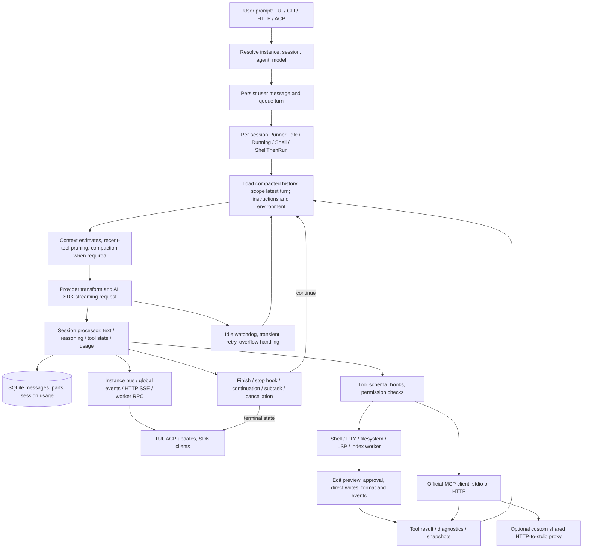

# Harness Architectural Audit & Production Blueprint

## 1. Executive Summary & Production Readiness Verdict

**Verdict: not ready for an unrestricted production release.** The repository contains a substantial, capable Bun/OpenTUI coding harness, but its authentication defaults, edit semantics, shared MCP proxy, failure reporting, and package closure need correction before it can make credible production safety claims. This is a **static source audit**, not a penetration test, dependency vulnerability scan, build certification, or runtime benchmark.

### Scope, evidence, and limits

- Repository: `projects/nocowboy`, relative to the enclosing NoCowboy workspace.
- Source baseline: `6e76dd7d24e6f1c4a8881dece9aff0aab6f84e33`; audit date: 2026-09-25. Source references below are repository-relative, with one-based inclusive line ranges against that baseline.
- Only existing local source, manifests, lockfiles, configuration, scripts, documentation, and tests were inspected. No dependencies were installed; no package manager, build, application, dev server, typecheck, test suite, or runtime benchmark was run. No remote service was contacted to validate the application. Competitor claims were not externally researched under the local-files-only constraint.
- **Fact** means directly observable source or manifest content. **Static inference** means a consequence inferred from that content and its callers. **Not runtime-verified** applies to every behavioral, exploitability, performance, integration, build, and test-outcome conclusion here. **Target** means a proposed acceptance criterion, not a measured result.
- The full tracked-file inventory was examined for topology and source closure. The inventory contains **4,547 tracked paths**, approximately **778,692 text lines** including generated code, fixtures, documentation, and line-count conventions; **761 paths** match test-related naming. There are **29 tracked symlinks**, **27 dangling in this checkout**, including workspace links. This is not equivalent to 778,692 lines of semantic review. Deep review focused on reachable control flow, trust boundaries, edit engines, streaming, indexing ownership, packaging, and their associated tests. Generated SDK/model tables, translations, assets, and many individual tests were inventoried or sampled, not verified line by line. A claim of exhaustive atomic coverage would be false.
- Read-only text searches, source extraction, manifest parsing, and inventory scripts were used. Local instructions requesting installation, localhost MCP contact, or typechecking were subordinate to the explicit static-only scope.
- No source fixes were applied. All changes shown below are proposed, **untested** refactors or explicit containment measures. Missing modules and third-party API declarations prevent promising that every proposal is a drop-in compiled patch. Full architectural fixes are distinguished from immediate containment; implementing them requires a separate authorized task.

### Overall System Health Score

**Overall: 40/100 — an equal-weight architectural judgment, not a benchmark or probabilistic reliability estimate.** An absent build verification does not prove every distribution is broken; unresolved source imports do prevent certifying this checkout as reproducible.

| Dimension | Score | Evidence-based rationale |
|---|---:|---|
| Stability | 30 | Same-file SEARCH/REPLACE loses edits; worker errors can leave RPC pending; completion reports success on failure; retry and step limits are incomplete. |
| Security | 25 | Predictable daemon credential, permissive packaged policy, unsafe optional plugin registry, and incomplete destination authorization. Loopback defaults and existing permission/config guards reduce exposure but do not repair these boundaries. |
| Performance | 45 | Workers, SQLite WAL, streaming, compaction, and cached context are useful foundations. Unbounded event queues, output spill writes, body buffering, and parse-tree ownership create identifiable resource risks. No latency/RSS/cache-hit measurements exist from this audit. |
| Extensibility | 60 | Typed services, official MCP client, ACP, generated SDK, hooks, modes, and provider adapters offer substantial extensibility. Parallel compatibility layers and broken package contracts undermine it. |
| Competitive posture | 40 | Local-first orchestration, project/task integrations, and multiple interfaces are promising. Correctness, reproducibility, and an evidence-backed evaluation suite are prerequisites to displacement claims. |

### Current State Analysis

The initial premise needs correction: this is **not primarily a VS Code webview extension fork**. Its active product is a Bun CLI/TUI built on OpenCode/Kilo-derived modules, with Effect services, SQLite persistence, HTTP/SSE and PTY endpoints, ACP, an SDK, and optional local MCP processes. It also contains a separate Rust memory daemon. The browser UI package is a component library; an earlier web-console application has been removed or disabled in the build path. Editor integration exists through ACP/editor context rather than an inspected, active VS Code extension workspace.

There are real safeguards: per-session runner synchronization, abort-aware LLM streaming, idle-stream detection, scoped cleanup, permission evaluation, protected configuration checks, external-directory checks, encoding/BOM preservation, output truncation, compaction, snapshotting, and sanitization in the markdown UI. The report does not erase those safeguards to inflate findings. Conversely, a permission prompt is not an OS sandbox, an LSP diagnostics cache is not a test result, and a declaration that a task is complete is not confirmation from the task service.

### Primary Bottlenecks

1. **Trust boundaries are inconsistent.** The daemon fixes its password to a public constant; the optional shared MCP proxy has no caller authentication; packaged permission rules allow everything while resembling a deny/ask policy. A network-reachable deployment magnifies these defects.
2. **Mutation and orchestration lack end-to-end invariants.** Multiple tools write files without a shared transaction/approval-version contract. Same-file replacements overwrite one another. Completion can be falsely reported, RPC failures can hang callers, and resource/cost limits are not uniformly enforced across continuations.
3. **The fork is not a closed, reproducible product source tree.** Missing workspace implementations, incorrect symlink generation, package export/file mismatches, and a stub gateway coexist with release scripts and broad feature claims. Correctness and release closure should precede new orchestration features.

**Registry:** 29 findings: **2 conditional P0**, **21 P1**, **6 P2**, **0 standalone P3**. Polish and documentation cleanup are included in Section 4 rather than manufacturing low-value findings. P0 conditions are explicit; neither means an unauthenticated Internet-facing service was observed running.

## 2. Full Architecture Topology & Data Flow

### Repository Topology and Build Surface

| Area | Ground truth and role | Audit depth |
|---|---|---|
| Root `package.json`, `bun.lock`, `turbo.json` | Bun 1.3.14 workspace, Turbo task graph, catalog versions, shell setup/postinstall/release scripts. Root and CLI share the `nocowboy-tui` name. Ten workspace entries; eight source workspaces present. | Manifests/task graph/closure reviewed. |
| `packages/opencode` | Main CLI/TUI, agent/session engine, HTTP API, tools, ACP, permissions, SQLite, MCP, custom `nocowboy/` additions. ~1,630 tracked paths / 448k text lines including tests. | Core paths and failure boundaries deeply traced; UI/test breadth sampled. |
| `packages/core` | Shared config, flags, filesystem, models/provider utilities and compatibility abstractions. ~175 paths / 94k lines; the generated model snapshot alone is ~71.7k lines. | Shared helpers relevant to callers reviewed; generated catalog sampled. |
| `packages/llm` | Provider/model abstractions and supporting code, ~136 paths / 18k lines. Does not replace the active `opencode/src/session/llm.ts` path. | Providers, manifests and overlapping responsibilities reviewed. |
| `packages/nocowboy-indexing` | Existing tree-sitter parsing, language queries, scan/ignore rules, embeddings, vector stores and worktree-aware indexing. ~150 paths / 23k text lines. | Parsing ownership, worker integration, store/scan architecture reviewed. |
| `packages/nocowboy-gateway` | ~40 paths / 847 text lines; important entry points replaced with stubs. | Public contract and runtime caller mismatch reviewed. |
| `packages/plugin`, `packages/sdk/js` | Plugin API and generated HTTP clients/server launch wrappers; ~10 and 47 paths respectively. | Public exports/build paths reviewed; generated endpoint inventory sampled. |
| `packages/ui` | Solid/Vite component library, markdown/diff/message rendering, styles, translations; ~1,635 paths / 64k text lines. | Rendering boundaries and data flow reviewed; translations/assets sampled. |
| `packaging/config`, `packaging/mcp-servers` | Distributed default policy and local integrations; MCP source plus checked-in build output (~277 paths / 20k text lines). | Default configuration, registry and selected integrations deeply reviewed; not every server method exhaustively audited. |
| `packaging/nocowboy-daemon` | Separate Rust executable: memory watcher, signing identity, git commits, HTTP endpoint. Four tracked files / ~3.1k text lines. | Identity/storage/request handling reviewed. |
| `script/`, `scripts/`, `packaging/*.sh` | Generation, cross-platform packaging, installation and publishing; legacy upstream maintenance. | Release effects and workspace/path assumptions reviewed. |
| `docs/`, feature docs, tests | Intent, proposed competitors, regressions and stale descriptions. ~235 doc paths / 21.7k lines. | Used as supporting intent, never as proof of implementation or passing tests. |

Important dependency families in the manifests/lockfile include Effect `4.0.0-beta.65`, AI SDK `6.0.168`, MCP SDK `1.29.0`, OpenTUI `0.4.1`, Solid `1.9.12`, tree-sitter `0.25.10`, Drizzle beta packages, SQLite, LanceDB/Qdrant, provider SDKs, DOMPurify, marked/Shiki, `@lydell/node-pty`, TypeScript `5.8.2`, and a TypeScript native preview. These are **declared/resolved metadata**, not verification of installed code or security status. Beta/native/version breadth increases integration work; it is not evidence of a CVE.

**Entry and build paths:** `packages/opencode/src/index.ts` registers lazy Yargs commands; `cli/cmd/tui/thread.ts` starts/attaches the TUI and worker; `cli/cmd/run.ts` provides CLI execution; serve/daemon commands expose the HTTP API; `cli/cmd/acp.ts` serves ACP over stdio. `packages/opencode/script/build.ts:274-358` uses **Bun.build**, Solid transforms, platform targets, multiple workers and native/assets sidecars. Its entrypoints include the main CLI, parser, TUI, export and indexing workers. The build script also contains dependency installation and binary smoke execution, which were not invoked. This is not a tsup/esbuild-based main executable just because such tools might appear transitively.

The UI uses Vite; the SDK generator invokes the CLI/OpenAPI generation and then code generation/TypeScript; the plugin uses `tsc`; the Rust daemon uses Cargo. The web-console builder in `packages/opencode/script/build.ts:89-93` is a no-op. SDK generation currently depends on being able to load the CLI and its unresolved workspace dependencies.

### Runtime Flowchart / Sequence



The diagram describes observed call structure, not a verified sequence timing trace. Permissions are above tools, while direct authenticated PTY API calls have a different trust model. The independent Rust daemon is not on the main prompt execution path.

### Subsystem Breakdown

**Context & Memory Subsystem.** `session/prompt.ts`, `session/system.ts`, `session/compaction.ts`, `session/message-v2.ts`, `nocowboy/session/overflow.ts`, provider transforms, and instructions assemble the prompt. The engine estimates text tokens, reserves output capacity, detects context pressure, preserves a recent tail, summarizes, and can chunk fallback summaries. Normal tool pruning is opt-in unless configured (`session/compaction.ts:315-316`); the packaged configuration enables it. This is not a guarantee of optimal token usage. Character-based estimation, tool schemas, images, cache accounting and provider-specific limits need calibrated fixtures.

The LLM path sorts tool definitions and organizes stable system blocks, which can improve cache eligibility. Actual provider prompt-cache hit ratios are **not runtime-verified**. The environment cache includes model-specific and changing integration data under a directory-only key (CTX-01). Editor details are separately injected dynamically; this report does **not** claim active editor files necessarily share that staleness. The regex/directory repomap is distinct from the existing AST/embedding index. The latter already has scanner ignore handling, language-specific queries, workers, stores, and worktree baseline/delta handling. The roadmap therefore calls for unifying these facilities, not “adding tree-sitter from scratch.”

**Agent Orchestration Engine.** `session/prompt.ts:1729-2033` owns repeated model/tool steps. `session/run-state.ts`, `effect/runner.ts` and the NoCowboy runner patch use synchronized state/latches and scoped cleanup. There are existing defenses against starting work before runner state is published. Queue ownership, cancel versions, overflow retries, stop hooks, followups, background tasks, subagents and team/mailbox primitives are present. `session/processor.ts` persists partial parts, snapshots, errors and tool state, with cleanup and bounded waiting for tool completion. These are substantive foundations, not an unguarded while-loop alone. However, budgets are checked on user-turn construction rather than every spend boundary, step limits remain model instructions, and worker-level failures are not universally terminalized.

**MCP & Extension Ecosystem.** `mcp/index.ts` uses official SDK clients, tool conversion, HTTP OAuth, stdio, resources, prompts, cached tool definitions, list-change handling and scoped client disposal. The inspected remote path uses Streamable HTTP; legacy SSE fallback is not established. `nocowboy/mcp/lifecycle.ts` actually launches `proxy-standalone.mjs`, not merely the similar TypeScript proxy. That proxy is a separate protocol implementation with shared IDs, permissive HTTP and incomplete bidirectional notification/session semantics. Raw NUTAUSIK helper fetches also bypass the full SDK handshake and typed error surface. Tool support, proxy compliance and downstream server correctness must be assessed independently.

**Execution Sandbox & Tool Runtime.** Shell parsing uses syntax-tree information and permission patterns, handles working directories, tracks output, kills/cleans up scoped processes, and truncates user-visible output. PTY supports editor/terminal interaction through the API. These generally execute with the host user's authority. `nocowboy/sandbox.ts` is an optional, unintegrated Docker command-string helper, not an active sandbox policy. Filesystem tools preserve encoding/BOM, show diffs, apply formatting and diagnostics, and use snapshots, but do not share a cross-tool transaction protocol. The ordinary edit tool has a semaphore; that does not serialize `write`, `apply_patch`, `search_replace`, external editors and multiple processes against one another.

**UI/Presentation Bridge.** OpenTUI/Solid provides terminal rendering and interactive session state. The main server uses Effect's HTTP API/router services under `server/routes/instance/httpapi`, with SSE and raw PTY WebSocket handling; describing the entire runtime as Hono based would be inaccurate. The TUI worker serializes ordinary fetch responses using `response.text()` (`cli/cmd/tui/worker.ts:51-68`) and separately forwards global events (`:43-46`). Large ordinary response bodies incur full buffering/copies; this does **not** establish that the normal live event path is buffered until completion. RPC lacks rejection/deadline ownership (IPC-01). UI markdown uses DOMPurify; no blanket markdown XSS finding is justified. ANSI escape/title behavior and native terminal parser guarantees remain a dependency-level verification gap.

**Storage and observability.** `storage/db.ts` initializes SQLite with WAL, busy timeout, cache settings and migrations. Filesystem-era docs do not supersede that implementation. Structured logs, usage fields and tracing integration exist; the repository is not wholly uninstrumented. The missing telemetry workspace blocks a reliable interpretation of telemetry identity/bootstrap behavior. The session-export pipeline includes eligibility controls and secret scrubbing; inspected callers discard failed scrubbing results, so a raw-event return inside a scrubber failure object is not by itself a confirmed exfiltration path.

## 3. Atomic Code Review & Issue Registry

Severity reflects impact **and reachability**, not the user's example label alone. P0 denotes a stop-ship security/data-destruction path under the stated deployment conditions; P1 denotes serious correctness, resource, safety or release failure; P2 denotes bounded/conditional design debt. Every failure scenario below is a **static inference, not runtime-verified**. Original excerpts are literal selected lines; omitted surrounding code is not implied absent. Proposed code is not executed or compiled.

### 3.1 Security, Authorization and Distribution Defaults

| ID | File & Line Range | Category | Severity | Description |
|---|---|---|---|---|
| SEC-01 | `packages/opencode/src/nocowboy/daemon/daemon.ts:183-202,315-323` | Authentication | P0 conditional | Predictable daemon password; high-impact if reachable by an untrusted caller. |
| SEC-02 | `packaging/mcp-servers/plugin-registry/src/index.ts:104-142` | Command/path injection | P0 conditional | Active registry tools can delete outside managed roots or execute shell-injected registry values. |
| SEC-03 | `packages/opencode/src/tool/apply_patch.ts:159-167,224-235,254-258` | Authorization | P1 | Move destination excluded from edit permission patterns. |
| SEC-04 | `packaging/config/nocowboy.json:98-119` | Unsafe default policy | P1 | Regex-looking rules are interpreted as globs; final wildcard/global allow defeats intended prompts. |
| SEC-05 | `packaging/nocowboy-daemon/src/main.rs:162-203,247-251,786-802,875-883` | Secret lifecycle | P1 | Generated signing key is under the directory committed with `git add -A`. |

#### SEC-01 — Replace the daemon's public credential and rotate existing state

**Original:**

```ts
const password = "nocowboy"
const token = auth(password)
// launch environment:
NOCOWBOY_SERVER_USERNAME: username,
NOCOWBOY_SERVER_PASSWORD: password,
```

The launch environment overrides inherited credentials. The default loopback binding reduces exposure but does not authenticate another local user/process. Explicit network binding or mDNS selection can make the server reachable beyond loopback; authenticated PTY creation can launch a process (`server/routes/instance/httpapi/handlers/pty.ts`, `pty/index.ts:177-221`). A known password therefore defeats the meaningful authentication boundary. No listening service or successful exploit was observed.

**Exact local replacement:** import `randomBytes` from `node:crypto`; replace the constant with `randomBytes(32).toString("base64url")`. Store the resulting auth state through the existing private-state path. **Required companion change:** before the reuse return at 189-190, mark any state containing the legacy credential as requiring restart/rotation; generating a new password only for new daemons leaves old ones vulnerable. State-file field names must be used from its schema, rather than adding an unrelated token field.

```ts
import { randomBytes } from "node:crypto"
// At credential creation:
const password = randomBytes(32).toString("base64url")
const token = auth(password)
```

For migration, a safe immediate operational policy is to reject reuse of pre-migration state using an explicit state-format version, terminate/restart through the existing locked lifecycle, and publish versioned private state only after readiness. Direct `serve` must reject non-loopback binding without a configured strong credential. Random credentials alone do not protect cleartext HTTP on an untrusted network; use an authenticated encrypted transport for that deployment.

**Future verification:** fresh/reused/legacy daemon state, custom password precedence, loopback versus wildcard/mDNS binding, PTY denial without a valid credential. None executed.

#### SEC-02 — Disable the registry mutation tools until they use safe paths and argv

**Original:**

```ts
const name = args.name as string
const skillDir = join(SKILLS_DIR, name)
execSync(`rm -rf "${skillDir}"`, { stdio: 'ignore' })
```

```ts
execSync(`git clone ${entry.source} ${targetDir} 2>/dev/null && cd ${targetDir} && npm install 2>/dev/null`, { stdio: 'ignore' })
```

`name = ".."` resolves to a parent that normally exists and passes the existence check. Quoting does not prevent traversal, and shell interpolation of names/registry sources introduces another execution boundary. The registry response is cast rather than validated (`:73-78`). Package installation also intentionally executes third-party lifecycle scripts without an explicit trust boundary. Severity is P0 **when this optional server/tool is enabled and reachable**; the packaged config enables a plugin-registry entry, but a successfully installed/running server was not established.

**Exact immediate containment in the tool switch**, preceding both mutation implementations:

```ts
case 'plugin_install':
case 'plugin_remove':
  throw new Error('Registry mutation is disabled pending path and supply-chain hardening')
```

Remove the old duplicate cases when applying this change. Read-only search/list can remain. The subsequent implementation must validate slugs, canonicalize the managed root, disallow symlink targets, use `fs.rm` and `execFile` argument arrays, verify registry schemas/source hosts and pinned revisions, and expose installation/script execution as an explicit trust decision. A safe deletion primitive for that later refactor is:

```ts
import { lstat, realpath, rm } from 'node:fs/promises'
import { dirname, join } from 'node:path'

async function removeManaged(root: string, name: unknown): Promise<void> {
  if (typeof name !== 'string' || !/^[a-z0-9][a-z0-9._-]{0,63}$/i.test(name)) {
    throw new Error('Invalid plugin name')
  }
  const base = await realpath(root)
  const target = join(base, name)
  const info = await lstat(target)
  if (info.isSymbolicLink() || !info.isDirectory()) throw new Error('Invalid plugin directory')
  if (dirname(await realpath(target)) !== base) throw new Error('Path outside plugin root')
  await rm(target, { recursive: true, force: false })
}
```

This is a managed-directory primitive, **not a defense against a hostile same-UID process racing the filesystem**. Keep mutation disabled until the complete install/remove workflow is reviewed. Do not demonstrate this issue by running a deletion command.

#### SEC-03 — Authorize both sides of a move

**Original:**

```ts
const relativePaths = fileChanges.map((c) => path.relative(instance.worktree, c.filePath).replaceAll("\\", "/"))
```

The move destination is checked for external-directory access, but same-worktree destination edit rules are absent from `patterns`. A source allowed by policy can be moved over a destination denied by a user path rule. The separate protected-config check examines move metadata; **this is not a claim that that existing special config guard is universally bypassed**.

**Replace the declaration exactly:**

```ts
const relativePaths = [...new Set(
  fileChanges.flatMap((c) => [c.filePath, ...(c.movePath ? [c.movePath] : [])])
    .map((file) => path.relative(instance.worktree, file).replaceAll("\\", "/")),
)]
```

Destination existence/content must also enter the reviewed diff (EDIT-02), and validation must be repeated against the committed version (EDIT-04). Verify allow-source/deny-destination, outside-worktree move, symlink aliases and special configuration protections later.

#### SEC-04 — Make default permission semantics match the policy's appearance

**Original:**

```json
"permission": {
  "*": "allow",
  "bash": {
    "^(sudo\\s+)?rm\\s+-rf\\s+/\\s*$": "ask",
    "*": "allow"
  }
}
```

The permission evaluator uses wildcard matching and last matching rules, not a regular-expression policy engine. Regex syntax therefore does not have the advertised semantics, and the trailing wildcard allows the operation in any event. The global allow/YOLO path further undermines the appearance of guarded execution. This default is distributed by the installer; its effect is not a theoretical unused example. Shell tools intentionally execute commands; the defect is the misleading and ineffective policy, not the existence of a shell tool.

**Replace the complete packaged permission object with this conservative baseline:**

```json
"permission": {
  "*": "ask",
  "read": "allow",
  "glob": "allow",
  "grep": "allow",
  "bash": "ask",
  "edit": "ask"
}
```

Any additional allowances should use the actual glob semantics, ordered deliberately, with protected config rules retained by the evaluator. Keep unrestricted operation an explicit user-selected mode. Do not attempt to secure an arbitrary shell with a blacklist of a few destructive spellings.

#### SEC-05 — Keep private identity material outside auto-committed memory

**Original:**

```rust
let key_path = memory_dir.join("identity").join("id_ed25519");
// ...
fs::write(&key_path, &secret_hex)
// ...
.args(["add", "-A"])
.current_dir(memory_dir)
```

The daemon initializes a git repository in `memory_dir`, creates the signing key inside it, and auto-commits directory changes. File mode 0600 does not prevent the same process from storing the secret in git objects. No actual key/history leak or remote push was observed. An existing user ignore rule could prevent staging; the default source does not establish that safeguard. There is also a write-then-chmod exposure window.

**Exact containment:** disable automatic commits in the default configuration and stop staging all files until the tracked-data contract is defined. A narrowly scoped staging command can replace `git add -A` only for known public content; it must not include `identity/`, databases, credentials or imported opaque files. Do not claim that adding `.gitignore` removes an already tracked key.

**Secure key creation primitive for the refactor:** move the key to a private application state directory **outside** `memory_dir`; on Unix create it atomically with private mode, propagating errors rather than continuing with an ephemeral identity.

```rust
use std::io::Write;
#[cfg(unix)]
use std::os::unix::fs::OpenOptionsExt;

fn write_new_secret(path: &std::path::Path, secret: &[u8]) -> std::io::Result<()> {
    let mut options = std::fs::OpenOptions::new();
    options.write(true).create_new(true);
    #[cfg(unix)]
    options.mode(0o600);
    let mut file = options.open(path)?;
    file.write_all(secret)?;
    file.sync_all()
}
```

Create/protect the parent directory as part of that state API; Windows needs an ACL-aware equivalent. Change `load_or_generate` to return `Result` and make startup fail on unsafe persistence. If an operator later confirms a committed private key, rotate it and remediate history separately; this audit did not inspect personal daemon data.

### 3.2 File Mutation, Matching and Recovery

| ID | File & Line Range | Category | Severity | Description |
|---|---|---|---|---|
| EDIT-01 | `packages/opencode/src/tool/search_replace.ts:88-95,157-195,222-227` | Data integrity | P1 | Multiple blocks for the same file are computed from the original and overwrite one another; ambiguous searches choose the first occurrence. |
| EDIT-02 | `packages/opencode/src/tool/apply_patch.ts:81-86,159-167,243-258` | Destructive preview mismatch | P1 | Add and move can overwrite existing destination content without presenting its actual removal in the preview. |
| EDIT-03 | `packages/opencode/src/tool/edit.ts:237-259,343-372,703-713` | Fuzzy matching | P1 | Zero similarity threshold accepts a block based on anchors despite differing internal contents. |
| EDIT-04 | `packages/opencode/src/tool/apply_patch.ts:224-276`; `packages/opencode/src/tool/search_replace.ts:211-227` | Concurrency / durability | P1 | Approval-to-write races and partial multi-file writes lack a shared versioned commit protocol. |

#### EDIT-01 — Stage replacements cumulatively and reject ambiguity

**Original:**

```ts
const read = yield* EncodedIO.read(filePath)
const source = Bom.split(read.text)
const fileEdit = prepareFileEdit(filePath, block, source.text)
edits.push({
  filePath,
  newFullContent: fileEdit.newFullContent,
```

The actual read includes an error wrapper; the loop's relevant assignments are shown. Every block rereads the file before any prepared edit is written. For original `A\nB`, blocks `A→AA` and `B→BB` produce `AA\nB` and `A\nBB`; sequential writes leave `A\nBB`. No race or load is necessary. The preview can misleadingly show both intended changes. Separately, `indexOf` without uniqueness checks edits the first duplicate SEARCH block.

**Exact immediate fail-closed refactor:** declare `const seenPaths = new Set<string>()` before the parse loop; resolve canonical paths and reject repeated files before preparing any writes. Insert this after resolving `filePath`:

```ts
const canonical = yield* Effect.tryPromise(() => fs.realpath(filePath))
if (seenPaths.has(canonical)) {
  throw new Error(`Multiple SEARCH/REPLACE blocks for one file are temporarily unsupported: ${filePath}`)
}
seenPaths.add(canonical)
```

Use `import * as fs from "node:fs/promises"`. This containment deliberately reduces functionality and avoids silent loss. In `prepareFileEdit`, after the not-found branch insert:

```ts
if (old.length === 0 || contentOld.indexOf(old, index + 1) !== -1) {
  throw new Error(`SEARCH block must match exactly once in ${filePath}`)
}
```

**Full refactor contract:** use a `Map<canonicalPath, { original, staged, encoding, bom }>`; each block applies to `staged`, not disk; generate one original-to-final diff and one commit per file. Preserve sequential block semantics so a later block may intentionally search earlier output. Commit through EDIT-04's shared mutation layer. Canonical paths do not alone solve hardlink aliasing or external concurrent writers.

**Future regression cases:** two disjoint blocks in one file, two dependent blocks, duplicate textual matches, aliases, CRLF/BOM, failure in a later block, and a second file. Existing test files are not evidence these scenarios pass.

#### EDIT-02 — Do not preview an overwrite as an empty-file addition

**Original:**

```ts
case "add": {
  const oldContent = ""
```

```ts
yield* EncodedIO.write(change.movePath!, Bom.join(change.newContent, change.bom), change.encoding)
yield* afs.remove(change.filePath)
```

An existing destination's contents are not the assumed empty string. This can hide lost work in an addition preview or in a move. The test at `packages/opencode/test/tool/apply_patch.test.ts:284-318` explicitly accepts overwriting on Add: the behavior is intentional in tests, but the preview/safety contract remains problematic. Calling it an accidental parser bug would misstate the evidence.

**Exact conservative change:** import `lstat` from `node:fs/promises` and add this helper:

```ts
async function requireAbsent(file: string): Promise<void> {
  try {
    await lstat(file)
  } catch (error) {
    if ((error as NodeJS.ErrnoException).code === "ENOENT") return
    throw error
  }
  throw new Error(`Refusing to overwrite existing patch destination: ${file}`)
}
```

Call `yield* Effect.tryPromise(() => requireAbsent(filePath))` at the start of Add and, for moves, call it on `movePath` during preparation. A deliberate overwrite must instead read the destination, include its deletion in the actual approved diff, and acquire a versioned commit lease. **This preflight is not a race-free no-clobber commit**; exclusive creation or an equivalent committed path policy belongs in EDIT-04. Update the existing intentional-overwrite test to the chosen explicit contract.

#### EDIT-03 — Disable permissive block-anchor fallback by default

**Original:**

```ts
const SINGLE_CANDIDATE_SIMILARITY_THRESHOLD = 0.0
// ...
if (similarity >= SINGLE_CANDIDATE_SIMILARITY_THRESHOLD) {
  break
}
```

With one anchor candidate, the first compared line can have zero similarity and still satisfy the threshold. The tool can replace a stale or wrong interior block. The error text later says the search must match exactly even though the fallback is permissive. Large lines also allocate a two-dimensional Levenshtein matrix (`:244-259`), but no runtime cost is asserted.

**Exact conservative replacement at the default replacer list:**

```ts
for (const replacer of [SimpleReplacer]) {
```

Leave the existing unique-match and `replaceAll` logic intact. This removes all approximate matching from the default write path, including other fallbacks that could otherwise still rewrite an approximate region. Offer normalized/fuzzy matching only as an explicit preview-and-reapprove mode with the real matched range, bounded line lengths/work, and no ambiguity. Merely changing zero to an arbitrary threshold does not establish semantic correctness.

#### EDIT-04 — Introduce one versioned mutation service, not independent direct writes

**Original:**

```ts
for (const change of fileChanges) {
  // per operation:
  yield* EncodedIO.write(change.filePath, Bom.join(change.newContent, change.bom), change.encoding)
}
```

Preparation and permission can be separated by human approval latency. An editor or another tool can change a file in that interval. No shared expected-content compare occurs immediately before writing, and an error on file N can leave files 1…N−1 changed. Formatting introduces another mutation after the write. The ordinary edit semaphore is not a global cross-tool/cross-process lock. Git snapshots support inspection/recovery but do not make this loop transactional.

**Exact immediate guard for update/delete/move inputs**, inserted after approval and before the first write, using the already prepared `oldContent`:

```ts
for (const change of fileChanges) {
  if (change.type === "add") continue
  const current = yield* EncodedIO.read(change.filePath)
  if (Bom.split(current.text).text !== change.oldContent) {
    throw new Error(`File changed after patch preparation; re-read and reapprove: ${change.filePath}`)
  }
}
```

This detects many stale approvals but **does not close the check/write race**, verify destination versions, or provide rollback. A complete fix cannot honestly be expressed as one added `rename`. The required implementation is a shared `FileMutationService` used by **all four** write tools:

```ts
// New contract: this interface is proposed, not an existing implemented API.
type Mutation = {
  path: string
  expectedSha256: string | null // null means the path must not exist
  nextBytes: Uint8Array | null // null means delete
}
interface FileMutationService {
  commit(input: {
    operationID: string
    mutations: readonly Mutation[]
    approvedDigest: string
    signal: AbortSignal
  }): Promise<{ operationID: string; changedPaths: string[] }>
}
```

Implementation requirements: acquire canonical paths in a stable order; validate approved hashes and destination identity; stage encoded bytes on the same filesystem; include formatting in the staged preview; journal originals/stages; publish a recoverable commit state; replace individual files atomically; rollback or explicitly report partial application; recover interrupted journals on startup; emit events only for actual committed versions. An atomic rename is **per file**, not a multi-file transaction. Uncooperative external writers require conflict detection, not a false claim that process-local locks control editors. Until this is implemented, describe patch application as nontransactional and show exact partial results after failure.

### 3.3 Agent State, Cost Governance and Truthful Completion

| ID | File & Line Range | Category | Severity | Description |
|---|---|---|---|---|
| STATE-01 | `packages/opencode/src/session/prompt.ts:1105-1117,1746-1753,1903-1904,2017-2027` | Budget / loop bounds | P1 | Spend checks occur once per user turn; the agent step cap is advisory while tools remain enabled. |
| STATE-02 | `packages/core/src/flag/flag.ts:117-118`; `packages/opencode/src/session/retry.ts:26-65,134-164` | Recovery / availability | P1 | Retry limit defaults to undefined; header-bearing exponential delays can become extremely long. |
| STATE-03 | `packages/opencode/src/tool/complete_task.ts:144-194` | Silent failure / status integrity | P1 | HTTP/JSON-RPC/tool errors can be presented as successful completion. |

#### STATE-01 — Enforce limits at every dispatch boundary

**Original:**

```ts
// Cost governance: the session row carries cumulative usage, so the budget
// is checked once per turn, before the model is used.
const budgetInfo = yield* sessions.get(input.sessionID)
```

```ts
const maxSteps = agent.steps ?? Infinity
const isLastStep = step >= maxSteps
// ...
messages: [...modelMsgs, ...(isLastStep ? [{ role: "assistant" as const, content: MAX_STEPS }] : [])],
tools,
```

One user prompt can create many paid model calls. Checking only on new-user-message construction lets continuations exceed a configured “hard cap.” The step cap asks the model to stop rather than forbidding another tool cycle. Additional spend can occur in title generation, compaction and delegated work; the source has subtask cost propagation, but that is not an atomic reservation before concurrent work.

**Exact immediate enforcement:** import `evaluateBudget` from `@/nocowboy/budget` and place the following before dispatching a new model request in the loop, with `sessionID`, `sessions` and `config` already in scope:

```ts
const usage = yield* sessions.get(sessionID)
const budget = (yield* config.get()).budget
const evaluation = evaluateBudget({
  costUsd: usage.cost ?? 0,
  tokens: (usage.tokens?.input ?? 0) + (usage.tokens?.output ?? 0) + (usage.tokens?.reasoning ?? 0),
  budget,
})
if (evaluation.status === "exceeded") {
  throw new Error(`Budget reached: ${evaluation.kind} ${evaluation.spent}/${evaluation.limit}`)
}
```

This is intentionally a stop-at-cap containment; it must be documented if it overrides the existing downgrade policy. At the step boundary, replace advisory-only semantics with:

```ts
const maxSteps = agent.steps ?? Infinity
if (step > maxSteps) throw new Error(`Agent step limit reached: ${maxSteps}`)
const isLastStep = step === maxSteps
```

If a final summarization is desired, it needs an explicitly budgeted, tools-disabled call, not an extra unbounded turn. Move the shared budget gate ultimately into the provider-dispatch service so title, compaction, retries and child sessions cannot bypass it. Reserve estimated worst-case output spend under a root-session ledger, reconcile actual usage, and cap parallel reservations. Post-call metering alone cannot guarantee an exact dollar ceiling; provider billing may include failed requests or delayed usage. Specify whether cache-read tokens count toward the product's token limit rather than silently changing its meaning.

#### STATE-02 — Bound automatic retries and total recovery time

**Original:**

```ts
return number("NOCOWBOY_SESSION_RETRY_LIMIT")
```

```ts
if (opts.limit !== undefined && meta.attempt > opts.limit) {
  return Cause.done(meta.attempt)
}
```

```ts
export const RETRY_MAX_DELAY = 2_147_483_647
return cap(RETRY_INITIAL_DELAY * Math.pow(RETRY_BACKOFF_FACTOR, attempt - 1))
```

With the default undefined limit, retryable failures can continue indefinitely. The header-bearing branch has no 30-second cap like the no-header branch; its upper bound is about 24.9 days. Cancellation still exists, so this is not an uninterruptible deadlock claim. It is an availability/operator-expectation defect, and automatic replays after partial streams require a tool-side-effect policy.

**Exact replacements:**

```ts
// flag getter
return number("NOCOWBOY_SESSION_RETRY_LIMIT") ?? 5
```

```ts
// in policy, validate a finite nonnegative limit once before constructing Schedule:
const limit = Number.isInteger(opts.limit) && (opts.limit ?? -1) >= 0 ? opts.limit! : 5
// replace the old condition:
if (meta.attempt > limit) return Cause.done(meta.attempt)
```

```ts
// replace cap; a deliberately bounded policy, not an RFC retry-after implementation:
function cap(ms: number) {
  if (!Number.isFinite(ms)) return RETRY_MAX_DELAY_NO_HEADERS
  return Math.max(0, Math.min(ms, RETRY_MAX_DELAY_NO_HEADERS))
}
```

Add a total recovery deadline and jitter for ordinary transient retries. If the provider explicitly requires a retry-after beyond the interactive budget, stop and show the later retry time instead of retrying earlier than requested. Do not automatically replay a tool with an uncertain side effect. Verify schedule attempt-number semantics and environment overrides before release.

#### STATE-03 — Fail closed on task-service errors

**Original:**

```ts
if (response.ok) {
  const data: any = yield* Effect.tryPromise(() => response.json())
  nutausikResult = data?.result?.content?.[0]?.text ?? "Task completed"
} else {
  nutausikResult = `NUTAUSIK returned HTTP ${response.status}`
}
// later, unconditionally:
`✅ Task '${params.slug}' completed successfully.`
```

An HTTP failure becomes a result string inside a success message. An HTTP 200 JSON-RPC error or MCP `isError` result can also become “Task completed.” Cached LSP diagnostics do not prove acceptance criteria, builds or tests passed. The five-second network timeout is useful but does not validate the response contract.

**Replace the response branch:**

```ts
if (!response.ok) throw new Error(`NUTAUSIK returned HTTP ${response.status}`)
const data: unknown = yield* Effect.tryPromise(() => response.json())
if (!data || typeof data !== "object") throw new Error("Invalid NUTAUSIK response")
const envelope = data as Record<string, unknown>
if (envelope.jsonrpc !== "2.0" || envelope.id !== 1 || envelope.error !== undefined) {
  throw new Error("NUTAUSIK rejected completion or returned an invalid response")
}
const result = envelope.result
if (!result || typeof result !== "object") throw new Error("Missing NUTAUSIK result")
const payload = result as Record<string, unknown>
if (payload.isError === true || !Array.isArray(payload.content)) {
  throw new Error("NUTAUSIK completion failed")
}
const texts = payload.content.flatMap((item: unknown) => {
  if (!item || typeof item !== "object") return []
  const part = item as Record<string, unknown>
  return part.type === "text" && typeof part.text === "string" ? [part.text] : []
})
if (texts.length === 0) throw new Error("Missing completion acknowledgement")
nutausikResult = texts.join("\n")
```

This fixes transport/envelope false success, **not semantic verification of task state**. Use the official MCP client and a typed `done` acknowledgement or a subsequent task-state read before claiming confirmed completion. Until that contract exists, use “Completion service acknowledged the request” and “No errors in currently available LSP diagnostics,” not “verification passed.” Model-supplied `ac_verified` is a claim; record its supporting checks separately.

### 3.4 Context, Prompt Freshness and Repository Mapping

| ID | File & Line Range | Category | Severity | Description |
|---|---|---|---|---|
| CTX-01 | `packages/opencode/src/session/system.ts:162-208` | Cache correctness | P2 | Directory-only cache reuses model-specific and changing memory/task context. |
| CTX-02 | `packages/opencode/src/nocowboy/repomap.ts:30-87,164-198` | Retrieval / latency | P2 | Synchronous, byte-unbounded first-500-file scan is separate from the AST index and reports sampled totals as totals. |

#### CTX-01 — Cache stable repository data, not the entire environment

**Original:**

```ts
const cacheKey = ctx.directory || process.cwd()
const cached = _envCache.get(cacheKey)
if (cached && now - cached.timestamp < _ENV_CACHE_TTL) return cached.lines
```

The result includes model/shell/date environment and NUTAUSIK context/coherence/handoff plus PM data. Switching model within the same directory can reuse the prior model description for up to the TTL; external task/memory changes can be stale. The cache is bounded by entry count, so an unbounded-cache claim would be wrong. Dynamic editor context is handled separately.

**Exact correctness-first refactor:** remove the early return and the `_envCache.set(...)`/eviction block from `environment`; then remove the unused cache declarations. Let the existing `RepoMap.generate` cache only its own repository summary. Reassemble model/environment and integration blocks per request. This trades additional integration calls for freshness; apply explicit per-source timeout and revision caching subsequently. A final cache key should include repository revision/config epoch, relevant model identity and source revision, rather than growing one global directory key. Provider prompt caching and application data caching are different mechanisms.

#### CTX-02 — Reuse the index and place byte limits on the fallback scan

**Original:**

```ts
const MAX_FILES = 500
const content = fs.readFileSync(filePath, "utf-8")
// ...
lines.push(`**Total:** ${totalFiles} files, ${totalLines.toLocaleString()} lines across ${modules.length} directories.`)
```

Five hundred files is not a byte/time bound. A large JSON/Markdown/SVG file can still dominate memory and block the execution thread during a cache miss. The scan ignores many dot directories but does not implement the main indexer's gitignore behavior. Regex imports/exports are not a symbol dependency graph, and first-encountered 500-file coverage is not relevance ranking. No actual startup delay was measured.

**Exact immediate scan guards:** add the constants and a scan-local counter, then insert the stat checks before `readFileSync`:

```ts
const MAX_FILE_BYTES = 512 * 1024
const MAX_SCAN_BYTES = 8 * 1024 * 1024
// inside scanDir, before walk:
let scannedBytes = 0
// before reading filePath:
const stat = fs.statSync(filePath)
if (stat.size > MAX_FILE_BYTES || scannedBytes + stat.size > MAX_SCAN_BYTES) continue
scannedBytes += stat.size
```

Replace “**Total:**” with “**Scanned subset:**” and disclose the limits in the output. Stat/read races and synchronous directory traversal remain; this is containment, not a bounded asynchronous index. The full refactor should retrieve summaries from the existing index worker, carry ignore/revision metadata, prioritize symbols referenced by the current task, and budget prompt tokens. Keep a bounded async fallback when indexing is unavailable, rather than blocking the prompt on complete embedding generation.

### 3.5 MCP Routing, Protocol Boundaries and Lifecycle

| ID | File & Line Range | Category | Severity | Description |
|---|---|---|---|---|
| MCP-01 | `packages/opencode/src/nocowboy/mcp/proxy-standalone.mjs:33-66,73-108` | Multiplexing / protocol | P1 | Clients share request IDs; responses can be delivered to the wrong caller, and malformed stdout poisons framing. |
| MCP-02 | `packages/opencode/src/nocowboy/mcp/proxy-standalone.mjs:73-120` | Local trust boundary | P1 | No authentication, Origin validation, or request-body cap on a destructive-tool proxy. |
| MCP-03 | `packages/opencode/src/mcp/index.ts:203-232` | Cancellation / timeout | P1 | Tool execution drops the caller abort signal and permits timeout extension on progress. |
| MCP-04 | `packages/opencode/src/mcp/index.ts:130,747-750` | Tool identity | P2 | Sanitized names collide and silently replace tools. |
| MCP-05 | `packages/opencode/src/nocowboy/mcp/lifecycle.ts:88-106` | Resource ownership | P2 | Parent log FD is never closed; startup reports running before readiness. |

#### MCP-01 — Namespace requests per transport and stop poisoning the line parser

**Original:**

```js
const id = String(msg.id ?? "")
const timer = setTimeout(() => { pending.delete(id); reject(new Error("timeout")) }, 300_000)
pending.set(id, { resolve, timer })
```

```js
buf += line
try {
  const msg = JSON.parse(buf)
  buf = ""
```

Two clients commonly start IDs at 1. The second overwrites the first resolver; the first child response resolves the second caller and the first timeout may delete a later mapping. String coercion also merges numeric and string IDs. Task integration helpers frequently use constant `id: 1`, making overlap plausible. The proxy's `sessionId` query parameter does not namespace the pending map. A non-JSON stdout line remains in `buf` forever and prevents later valid line-delimited messages from parsing. This supports cross-caller result confusion, not a claim that separate operating-system users were observed sharing a live instance.

**Replace the buffer/parser and request-forwarder with transport-owned IDs:**

```js
let nextID = 0
const pending = new Map()

function finish(id, error, value) {
  const entry = pending.get(id)
  if (!entry) return
  pending.delete(id)
  clearTimeout(entry.timer)
  if (error) entry.reject(error)
  else entry.resolve(value)
}

rl.on("line", (line) => {
  let msg
  try { msg = JSON.parse(line) } catch {
    console.error("[mcp-proxy] invalid JSON line from child")
    return
  }
  if (!msg || typeof msg !== "object" || msg.jsonrpc !== "2.0") return
  const entry = pending.get(msg.id)
  if (!entry) return
  // Only a response may settle a request; server requests need separate routing.
  if (!("result" in msg) && !("error" in msg)) return
  finish(msg.id, undefined, JSON.stringify({ ...msg, id: entry.originalID }))
})

function writeJSON(msg) {
  return new Promise((resolve, reject) => {
    if (!msg || typeof msg !== "object" || msg.jsonrpc !== "2.0" || typeof msg.method !== "string") {
      reject(new Error("Invalid JSON-RPC request"))
      return
    }
    const hasID = Object.hasOwn(msg, "id")
    if (!hasID) {
      proc.stdin.write(JSON.stringify(msg) + "\n", (error) => error ? reject(error) : resolve(""))
      return
    }
    if (typeof msg.id !== "string" && typeof msg.id !== "number") {
      reject(new Error("Invalid request ID"))
      return
    }
    if (pending.size >= 256) {
      reject(new Error("Proxy overloaded"))
      return
    }
    const id = `proxy:${++nextID}`
    const timer = setTimeout(() => finish(id, new Error("timeout")), 30_000)
    pending.set(id, { originalID: msg.id, resolve, reject, timer })
    proc.stdin.write(JSON.stringify({ ...msg, id }) + "\n", (error) => {
      if (error) finish(id, error)
    })
  })
}

function failPending(error) {
  for (const id of pending.keys()) finish(id, error)
}
proc.on("exit", () => failPending(new Error("MCP child exited")))
proc.on("error", failPending)
proc.stdin.on("error", failPending)
```

This precise replacement repairs request correlation and line poisoning, but **does not implement a compliant multi-session MCP server**. Notifications, server-initiated requests, cancellation-ID translation, initialization, stream resumability and per-client lifecycle still need explicit routing. The old proxy's GET sends an endpoint event and keepalives, not the full modern server transport contract. The preferred production refactor is official SDK server transports with one owned logical client session per upstream connection. Until that exists, restrict this adapter to its documented request/response subset; do not advertise full MCP passthrough.

#### MCP-02 — Authenticate local tool proxies and bound HTTP input

**Original:**

```js
"Access-Control-Allow-Origin": "*",
// ...
let body = ""
req.on("data", (chunk) => { body += chunk })
// ...
server.listen(port, "127.0.0.1", ...)
```

Loopback prevents ordinary remote network access but is not a per-user authorization boundary. Another local process can invoke configured tools. Browser access depends on browser/network protections, headers and origin; no browser exploit is claimed as verified. Wildcard CORS and missing Origin checks make the intended trust boundary weaker, and body accumulation has no byte bound.

**Exact fail-closed startup/request guards:** require a randomly generated per-proxy secret provisioned by the lifecycle owner, not a checked-in default. Insert before server creation and at the start of its callback:

```js
const secret = process.env.NOCOWBOY_MCP_PROXY_TOKEN
if (!secret || secret.length < 32) throw new Error("A private MCP proxy token is required")
// At request entry; reject browser origins unless deliberately supported:
if (req.headers.origin !== undefined || req.headers.authorization !== `Bearer ${secret}`) {
  res.writeHead(403)
  res.end()
  return
}
```

Remove wildcard CORS headers. Replace unbounded body collection with a byte-counting buffer capped, for example, at 1 MiB; reject `Content-Length` above that cap but also count actual chunks and destroy oversized requests. Set a request deadline and bounded concurrent requests. A private Unix-domain socket/OS equivalent is preferable for a host-only integration. **Deployment dependency:** lifecycle, stored connection config and all raw helper callers must be migrated together to send the token; this guard deliberately fails closed until they are. Do not pass the secret on process argv or print it in URLs/logs.

#### MCP-03 — Propagate cancellation and impose a total call deadline

**Original:**

```ts
execute: async (args: unknown) => {
  // ...
  return client.callTool(request, CallToolResultSchema, {
    resetTimeoutOnProgress: true,
    timeout,
  })
}
```

The active implementation builds `request` inline. The missing second AI SDK execute argument means its abort signal never reaches the MCP call. Session cancellation can stop awaiting the surrounding operation while a destructive remote tool continues. Progress can repeatedly refresh the timeout. Other scoped client cleanup exists, but terminating an entire shared client is not equivalent to canceling one invocation.

**Targeted replacement signature/options:**

```ts
execute: async (args: unknown, options) => {
  const params = withProjectDir(
    serverName ?? "",
    args as Record<string, unknown> | undefined,
    projectScoped ? currentProjectDir() : undefined,
  )
  const deadline = timeout ?? 60_000
  return client.callTool(
    { name: mcpTool.name, arguments: params },
    CallToolResultSchema,
    {
      signal: options.abortSignal,
      timeout: deadline,
      maxTotalTimeout: deadline,
      resetTimeoutOnProgress: false,
    },
  )
}
```

The precise installed SDK/AI SDK option declarations must be checked in a later authorized typecheck; they were not available as a verified dependency tree in this audit. Cancellation is cooperative and cannot undo an external side effect already committed. Report “cancellation requested/outcome unknown” where appropriate and require idempotency keys for retryable mutations. Long-running tools should expose progress/job handles rather than silently extending an interactive request forever.

#### MCP-04 — Detect tool-name collisions before publication

**Original:**

```ts
result[sanitize(clientName) + "_" + sanitize(mcpTool.name)] = convertMcpTool(mcpTool, client, timeout, clientName)
```

Names such as `a.b` and `a_b` sanitize to the same identifier. Even without sanitization, joining two names with `_` is not injective. Silent replacement can make the model call a different tool/server than intended. This is a configuration-dependent routing defect, not proof of a malicious server takeover.

**Exact replacement:**

```ts
const key = sanitize(clientName) + "_" + sanitize(mcpTool.name)
if (Object.hasOwn(result, key)) {
  throw new Error(`MCP tool identifier collision: ${key}`)
}
result[key] = convertMcpTool(mcpTool, client, timeout, clientName)
```

Ultimately use stable IDs with a collision-resistant suffix derived from the full server/tool tuple, retain a display-name mapping, and respect provider tool-name/length limits. Do not solve this with discovery-order numeric suffixes that change tool identity between requests.

#### MCP-05 — Close launch resources and verify readiness

**Original:**

```ts
const logFd = fs.openSync(logPath, "a")
const child = spawn("node", [proxyPath, String(port), cmd], {
  stdio: ["ignore", logFd, logFd],
  detached: true,
})
child.unref()
```

The child inherits the descriptors; the parent retains its opened FD. Repeated launches leak parent descriptors. The method also writes state and returns `running: true` without protocol readiness. In-memory `starting` only coordinates one process; the port registry's read/modify/write is not cross-process serialized. The FD leak is the directly bounded finding; readiness/race concerns require the same lifecycle refactor.

**Exact descriptor replacement:** resolve `proxyPath` before opening the FD, then:

```ts
const logFd = fs.openSync(logPath, "a")
let child: ReturnType<typeof spawn>
try {
  child = spawn("node", [proxyPath, String(port), cmd], {
    stdio: ["ignore", logFd, logFd],
    detached: true,
  })
} finally {
  fs.closeSync(logFd)
}
child.unref()
```

Attach an `error` listener immediately; await the spawned process and an authenticated readiness/initialize probe before publishing running state. Use the repository's file-lock facility for cross-process port/state updates and atomic state-file replacement. A health endpoint alone is insufficient if it belongs to a different process already on the port.

### 3.6 Worker RPC and Event Delivery

| ID | File & Line Range | Category | Severity | Description |
|---|---|---|---|---|
| IPC-01 | `packages/opencode/src/util/rpc.ts:5-11,19-50`; `packages/opencode/src/cli/cmd/tui/thread.ts:244-250` | Error/lifecycle protocol | P1 | Thrown worker methods and dead workers leave outstanding RPC promises without rejection or a deadline. |

#### IPC-01 — Make every request settle exactly once

**Original:**

```ts
const result = await rpc[parsed.method](parsed.input)
postMessage(JSON.stringify({ type: "rpc.result", result, id: parsed.id }))
```

```ts
const pending = new Map<number, (result: any) => void>()
return new Promise((resolve) => {
  pending.set(requestId, resolve)
  target.postMessage(JSON.stringify({ type: "rpc.request", method, input, id: requestId }))
})
```

A missing method, rejected fetch, malformed payload, serialization failure or worker crash can skip the response. The client stores only resolvers. `worker.onerror` logs but does not settle pending requests. A separate shutdown timeout does not cover ordinary fetch calls. This is a plausible indefinite wait and retention path under failure, not a measured deadlock.

**Exact protocol refactor pieces:** return structured success/error responses and retain reject/timer state. Replace the worker request branch with:

```ts
try {
  if (typeof rpc[parsed.method] !== "function") throw new Error("Unknown RPC method")
  const result = await rpc[parsed.method](parsed.input)
  postMessage(JSON.stringify({ type: "rpc.result", id: parsed.id, ok: true, result }))
} catch (error) {
  postMessage(JSON.stringify({
    type: "rpc.result", id: parsed.id, ok: false,
    error: error instanceof Error ? error.message : "RPC failed",
  }))
}
```

Wrap message parsing in its own validation/error boundary. In the client, replace `pending` and its result handling with the following shared settlement model:

```ts
type Pending = {
  resolve: (value: unknown) => void
  reject: (error: Error) => void
  timer: ReturnType<typeof setTimeout>
}
const pending = new Map<number, Pending>()
function settle(id: number, error?: Error, result?: unknown) {
  const call = pending.get(id)
  if (!call) return
  pending.delete(id)
  clearTimeout(call.timer)
  if (error) call.reject(error)
  else call.resolve(result)
}
function close(error = new Error("RPC worker closed")) {
  for (const id of pending.keys()) settle(id, error)
}
// On a validated rpc.result:
settle(parsed.id, parsed.ok ? undefined : new Error(parsed.error ?? "RPC failed"), parsed.result)
```

Replace the call body and correct the asynchronous return type:

```ts
call<Method extends keyof T>(
  method: Method,
  input: Parameters<T[Method]>[0],
): Promise<Awaited<ReturnType<T[Method]>>> {
  const requestId = id++
  return new Promise((resolve, reject) => {
    const timer = setTimeout(() => settle(requestId, new Error("RPC deadline exceeded")), 30_000)
    pending.set(requestId, { resolve: resolve as (value: unknown) => void, reject, timer })
    try {
      target.postMessage(JSON.stringify({ type: "rpc.request", method, input, id: requestId }))
    } catch (error) {
      settle(requestId, error instanceof Error ? error : new Error("RPC send failed"))
    }
  })
},
```

Return `close` from `client`, call it from worker error/termination and disposal paths, and isolate event-handler exceptions. Per-method deadlines and AbortSignal/cancel messages should replace a universal 30-second default for intentionally long operations. A timed-out call must be reported as an uncertain outcome if it could have mutated state; automatic retry is not safe merely because its promise rejected. A future discriminated request/response schema can remove the remaining generic cast without pretending JSON is type-safe.

### 3.7 Bounded Resources, Streaming and Index Ownership

| ID | File & Line Range | Category | Severity | Description |
|---|---|---|---|---|
| PERF-01 | `packages/opencode/src/tool/shell.ts:474-495,511-547` | Backpressure / disk errors | P1 | Spill writes ignore backpressure and lack an active error listener until finalization. |
| PERF-02 | `packages/opencode/src/bus/index.ts:55-84,90-98` | Event retention | P1 | Unbounded pub/sub queues can retain events behind slow subscribers. |
| PERF-03 | `packages/nocowboy-indexing/src/indexing/processors/parser.ts:208-280`; `packages/nocowboy-indexing/src/tree-sitter/index.ts:252-263` | Native/WASM ownership | P1 | Temporary parse trees are not explicitly released along success/early-return paths. |
| PERF-04 | `packages/opencode/src/tool/webfetch.ts:82-107` | Network/body bounds | P1 | Body is fully buffered before the 5 MiB check; request timeout does not visibly enclose body consumption. |

#### PERF-01 — Await spill writes and surface disk failures

**Original:**

```ts
if (file) {
  sink?.write(chunk)
}
// creation:
sink = createWriteStream(next, { flags: "a" })
```

The displayed tail is bounded, but the writable stream's internal queue can still grow when command output outruns disk. `write()` returns a backpressure signal that is ignored. The error listeners in `closeSink` are installed at finalization, not throughout active writes; a disk-full/permission/device error can therefore escape normal reporting. No memory profile or ENOSPC experiment was run.

**Targeted fix:** add `let sinkError: Error | undefined` beside `sink`. Immediately after `createWriteStream`, attach `sink.on("error", (error) => { sinkError = error })`. Replace the `if (file)` branch with an awaited write followed by metadata:

```ts
if (file) {
  const stream = sink
  return Effect.tryPromise(() => new Promise<void>((resolve, reject) => {
    if (sinkError) return reject(sinkError)
    if (!stream || stream.destroyed) return reject(new Error("Output spill stream unavailable"))
    stream.write(chunk, (error) => error ? reject(error) : resolve())
  })).pipe(
    Effect.andThen(ctx.metadata({ metadata: { output: last, description: input.description } })),
  )
}
```

Awaiting each write callback bounds this consumer's write backlog. Also join/observe the output-drain fiber: propagating an error into an unobserved fork is not enough. On output failure, stop the command through its existing scoped lifecycle and return a failed tool result containing the retained tail and spill error. Add per-command/directory spill quotas and retention cleanup. `closeSink` must preserve an earlier error rather than turning every close/error into success. These lifecycle changes require later integration verification.

#### PERF-02 — Bound subscriber retention without silently dropping deltas

**Original:**

```ts
const wildcard = yield* PubSub.unbounded<Payload>()
// per event type:
ps = yield* PubSub.unbounded<Payload>()
```

A subscribed consumer that cannot keep up can retain an arbitrarily long history. The SSE/network path and UI consumers must be evaluated independently; a fast consumer does not prove all subscribers are fast. Cleanup on disposal exists, so the risk concerns active slow consumers, not necessarily forgotten subscriptions.

**Exact bounded primitive change:**

```ts
const wildcard = yield* PubSub.bounded<Payload>(1024)
// in getOrCreate:
ps = yield* PubSub.bounded<Payload>(1024)
```

**Do not ship only those two lines.** Bounded backpressure can stall the agent behind a slow subscriber, including disposal publication. Complete the refactor with per-client mailboxes, a finite send deadline, explicit disconnection of lagging clients, sequence numbers and a snapshot/resume endpoint. Control-plane completion/error/cancel events need reliable delivery or recoverable state, while replaceable status previews can be coalesced. Dropping/sliding arbitrary token deltas silently corrupts a transcript. Shutdown must bypass blocked publication and release subscribers. The proposed capacity is a starting configuration target, not a measured optimum.

#### PERF-03 — Release each temporary tree in `finally`

**Original:**

```ts
const tree = language.parser.parse(content)
const captures = tree ? language.query.captures(tree.rootNode) : []
// multiple early returns and capture processing
return results
```

The tree is local and all returned `CodeBlock` values materialize ordinary text/metadata, but no `tree.delete()` appears around these paths. The companion parser helper similarly creates a tree then returns captures processed into strings without deleting it. Other shell parsing code explicitly deletes trees, showing the intended ownership pattern. Native/WASM heap retention is a **static inference**; garbage-collection/native-finalizer behavior and its magnitude were not measured.

**Exact structural edit in `processors/parser.ts`:** immediately after line 208 insert `try {`; place the existing capture/return logic (212-280) inside it; immediately before the method's closing brace insert:

```ts
} finally {
  tree?.delete()
}
```

In `tree-sitter/index.ts`, replace the body of the existing parse `try` with:

```ts
const tree = parser.parse(fileContent)
try {
  const captures = tree ? query.captures(tree.rootNode) : []
  const lines = fileContent.split("\n")
  return processCaptures(captures, lines, extLang)
} finally {
  tree?.delete()
}
```

Retain the outer error handler. Delete only after all node-derived values have been materialized; never return live nodes tied to a freed tree. Parser/query objects that are intentionally cached need a separate worker-disposal lifecycle. Verify success, empty captures, fallback, thrown query and repeated indexing with native-heap instrumentation later.

#### PERF-04 — Enforce the byte limit while consuming the body

**Original:**

```ts
const arrayBuffer = yield* response.arrayBuffer
if (arrayBuffer.byteLength > MAX_RESPONSE_SIZE) {
  throw new Error("Response too large (exceeds 5MB limit)")
}
```

A missing/false Content-Length allows complete allocation before rejection. Headers can arrive within the request timeout and the body can then stall. The inspected source does not place the timeout around body consumption; underlying transport behavior is a verification gap, not a reason to assume this local limit works.

**Replace body buffering with bounded stream consumption** and add `Stream` to the Effect import:

```ts
const chunks: Uint8Array[] = []
let bytes = 0
const arrayBuffer = yield* Stream.runForEach(response.stream, (chunk) =>
  Effect.sync(() => {
    bytes += chunk.byteLength
    if (bytes > MAX_RESPONSE_SIZE) throw new Error("Response too large (exceeds 5MB limit)")
    chunks.push(chunk)
  }),
).pipe(
  Effect.timeoutOrElse({ duration: timeout, orElse: () => Effect.die(new Error("Response body timed out")) }),
  Effect.map(() => {
    const result = new Uint8Array(bytes)
    let offset = 0
    for (const chunk of chunks) {
      result.set(chunk, offset)
      offset += chunk.byteLength
    }
    return result.buffer
  }),
)
```

This bounds retained chunks plus the final buffer, though a transport can deliver an already allocated oversized chunk. Keep scoped response finalization so timeout/overflow closes the body. The immediate patch gives acquisition and body separate time budgets; the final refactor should place one absolute deadline around acquisition, decompression, body read and conversion. Preserve the limit on decoded bytes, not only wire Content-Length. Validate Effect beta API typing later.

### 3.8 Package Closure, Publication and Provider Contracts

| ID | File & Line Range | Category | Severity | Description |
|---|---|---|---|---|
| BUILD-01 | `package.json:18-30`; `packages/opencode/package.json:105`; `packages/opencode/src/auth/index.ts:6`; `packages/opencode/src/session/llm.ts:37` | Missing source dependency | P1 | Telemetry and recorder workspaces are declared but absent; telemetry has live runtime imports. |
| BUILD-02 | `scripts/fix-symlinks.sh:23-32` | Installation correctness | P2 | Scoped and unscoped links use the same relative depth; tracked symlinks mask source closure. |
| BUILD-03 | `packages/plugin/package.json:11-18`; `packages/sdk/js/package.json:11-22` | Package exports | P1 | Exports point into `src`, while published file allowlists contain only `dist`. |
| BUILD-04 | `packages/nocowboy-gateway/src/provider.ts:1-2`; `packages/opencode/src/nocowboy/provider/provider.ts:15-35` | Runtime type contract | P1 | Stub async gateway factory is cast to a synchronous provider exposing `languageModel`. |

#### BUILD-01 — Restore or deliberately remove missing product modules

**Original:**

```json
"packages/nocowboy-telemetry",
"packages/http-recorder"
```

```ts
import { Telemetry } from "@nocowboy/telemetry"
import { Identity } from "@nocowboy/telemetry"
```

The directories are absent from tracked source while the lockfile and symlink script still reference them. Telemetry imports also occur in bootstrap/setup paths. A stale local installation or existing binary might run; that does not establish that a fresh build of this checkout has its required implementation. The recorder workspace's absence is manifest debt; telemetry's live imports make the source-closure defect more direct. No build was run to turn this static finding into a compiler-error claim.

**Exact required refactor:** either restore `packages/nocowboy-telemetry` with a reviewed package manifest exporting every currently imported runtime symbol, or remove its consumers and dependency entry as a coherent feature removal. Remove `packages/http-recorder` from root workspaces and `scripts/fix-symlinks.sh` if that feature is intentionally removed, then regenerate the lockfile only in a later authorized implementation task.

**Why no invented drop-in module is supplied:** the absent implementation defines identity/bootstrap/telemetry semantics that cannot be recovered from a manifest alone. A fake `any`-typed no-op would make source resolution appear fixed while changing behavior. This is an explicit remediation dependency, not a completed fix. Preserve real local identity semantics if telemetry reporting itself is removed. Add this exact source-closure check to a later release verification script:

```ts
import { existsSync } from "node:fs"
import { readFileSync } from "node:fs"
import { join } from "node:path"
const manifest = JSON.parse(readFileSync("package.json", "utf8"))
for (const workspace of manifest.workspaces.packages) {
  if (!existsSync(join(workspace, "package.json"))) {
    throw new Error(`Missing declared workspace: ${workspace}`)
  }
}
```

This verifier addresses these explicit paths only; a general glob workspace resolver and import/export closure check belong in release tooling. It was not executed as project code during this audit.

#### BUILD-02 — Generate links at the correct depth and refuse destructive replacement

**Original:**

```sh
ln -sf "../../$target" "$link"
```

For `node_modules/@nocowboy/core`, two parents correctly reach the repo root. For `node_modules/nocowboy-tui`, two parents reach outside it. The script also deletes existing directories and links rather than proving ownership. Missing target workspaces compound the problem. The audit found 28 tracked paths under node_modules; these should not substitute for a package manager's dependency graph.

**Replace the deletion/link block:**

```sh
if [ ! -d "$target" ]; then
    echo "Missing workspace target: $target" >&2
    exit 1
fi
if [ -e "$link" ] && [ ! -L "$link" ]; then
    echo "Refusing to replace non-symlink: $link" >&2
    exit 1
fi
case "$name" in
    @*/*) relative="../../$target" ;;
    *)    relative="../$target" ;;
esac
rm -f "$link" || exit 1
ln -s "$relative" "$link" || exit 1
```

Ensure the outer script propagates the loop/pipeline exit status and remove already identified missing workspaces first. The preferred end state is no custom symlink repair at all: correct unique workspace names and an ordinary lockfile-driven install. Remove tracked node_modules links through a reviewed source change; no dependencies were installed or deleted here.

#### BUILD-03 — Align publication exports with emitted files

**Original:**

```json
"exports": { ".": "./src/index.ts", "./tool": "./src/tool.ts", "./tui": "./src/tui.ts" },
"files": ["dist"]
```

Both packages' TypeScript configs emit JavaScript/declarations under `dist`. The SDK's inspected build script does not rewrite these exports. Workspace source imports may work while a published package omits every declared entrypoint. Publication was not performed; this is a static artifact-contract contradiction.

**Replace plugin exports:**

```json
"exports": {
  ".": { "types": "./dist/index.d.ts", "import": "./dist/index.js" },
  "./tool": { "types": "./dist/tool.d.ts", "import": "./dist/tool.js" },
  "./tui": { "types": "./dist/tui.d.ts", "import": "./dist/tui.js" }
}
```

**Replace SDK exports:**

```json
"exports": {
  ".": { "types": "./dist/index.d.ts", "import": "./dist/index.js" },
  "./client": { "types": "./dist/client.d.ts", "import": "./dist/client.js" },
  "./server": { "types": "./dist/server.d.ts", "import": "./dist/server.js" },
  "./v2": { "types": "./dist/v2/index.d.ts", "import": "./dist/v2/index.js" },
  "./v2/client": { "types": "./dist/v2/client.d.ts", "import": "./dist/v2/client.js" },
  "./v2/gen/client": { "types": "./dist/v2/gen/client/index.d.ts", "import": "./dist/v2/gen/client/index.js" },
  "./v2/server": { "types": "./dist/v2/server.d.ts", "import": "./dist/v2/server.js" }
}
```

Coordinate workspace development resolution/build ordering with this change; changing exports before generating dist can break source development. A source-only publication is another valid contract, but then `src` and its required runtime/types must be included deliberately. Later inspect the actual package tarball and import each public subpath from an isolated consumer.

#### BUILD-04 — Remove the false gateway adapter contract

**Original:**

```ts
export async function createNoCowboy() { return { models: [] } }
export async function createNoCowboyDebug() { return { models: [] } }
```

```ts
"@nocowboy/gateway": async () => createNoCowboy as unknown as (options: Record<string, unknown>) => BundledSDK,
```

The real factory returns a Promise of `{ models: [] }`, not a provider object with `languageModel`. The double cast hides the mismatch. Failure is conditional on selecting this adapter; direct providers may be unaffected. `0.0.0-stub` in the gateway manifest confirms intent to stub, not compatibility with active callers.

**Exact honest containment:** replace the stub export bodies with explicit unsupported failures, and remove the double cast from the bundled provider map by making its loader fail:

```ts
export const KILO_BUNDLED_PROVIDERS: Record<string, () => Promise<(options: Record<string, unknown>) => BundledSDK>> = {
  "@nocowboy/gateway": async () => {
    throw new Error("The NoCowboy gateway provider is unavailable in this distribution; configure a supported direct provider")
  },
}
```

Remove gateway choices/defaults from setup and documentation for this distribution. To restore the feature, implement a typed `LanguageModelV3` adapter and its streaming/tool/usage/error contract, not a shape assertion. Do not present a stub's existence as working multi-provider routing.

### 3.9 Latent Sandbox Debt

| ID | File & Line Range | Category | Severity | Description |
|---|---|---|---|---|
| DEBT-01 | `packages/opencode/src/nocowboy/sandbox.ts:28-38` | Inactive security abstraction | P2 | Unused Docker shell-string helper is not a sandbox; JSON escaping would not prevent host-shell expansion if activated. |

#### DEBT-01 — Use argv execution and an explicit sandbox policy

**Original:**

```ts
`-v "$(pwd):${workdir}"`,
`-w "${workdir}"`,
`bash -c ${JSON.stringify(command)}`,
```

No production call site was found for this helper. Therefore, claiming an active sandbox escape or assigning it P0 would be unjustified. If the returned string is later passed to a host shell, JSON double quotes do not disable `$()`/backtick expansion, and interpolated workdir has another shell boundary. The default images also use moving tags, and network/capability/resource policies are absent.

**Replace the command-string API with an argv launcher when integrating the feature:**

```ts
import { spawn } from "node:child_process"
import { realpath } from "node:fs/promises"

export async function spawnSandbox(command: string, hostDirectory: string, imageDigest: string) {
  if (!/^[a-zA-Z0-9./:_-]+@sha256:[a-f0-9]{64}$/.test(imageDigest)) {
    throw new Error("A pinned sandbox image digest is required")
  }
  const directory = await realpath(hostDirectory)
  if (directory.includes(",") || directory.includes("\n")) throw new Error("Unsupported mount path")
  return spawn("docker", [
    "run", "--rm", "--network=none", "--cap-drop=ALL",
    "--security-opt=no-new-privileges", "--pids-limit=256", "--memory=1g",
    "--read-only", "--tmpfs", "/tmp:rw,nosuid,nodev,size=128m",
    "--mount", `type=bind,src=${directory},dst=/workspace`,
    "--workdir", "/workspace", imageDigest, "bash", "-lc", command,
  ], { shell: false, stdio: ["ignore", "pipe", "pipe"] })
}
```

This removes host-shell interpolation; it is **not a complete secure sandbox implementation**. Decide UID mapping, credentials/env allowlists, network allowances, filesystem grants, daemon/root trust, child/container cleanup on abort and Windows/macOS behavior. The bound workspace remains writable. Integrate through the central tool runtime and keep host execution explicit when the sandbox is unavailable. Prefer removing the unused helper until those decisions are implemented, rather than implying its presence makes execution isolated.

## 4. Upstream Fork Drift & Technical Debt

### Upstream Artifacts

“Legacy” is not synonymous with “dead.” A Kilo/OpenCode name in an active compatibility API may be deliberate, while a NoCowboy-branded stub can be the actual problem. No remote upstream checkout was fetched, so this section assesses local provenance/contract conflicts, **not a quantified diff against today's upstream HEAD**.

| Artifact | Local evidence | Assessment and disposition |
|---|---|---|
| Rebranding-aware core plus custom hooks | `packages/opencode/src/nocowboy/`, `nocowboy_change` markers, provider/prompt integration points | Useful attempt to isolate custom behavior. Retain explicit extension seams; reduce invasive hooks around session state and provider contracts. Do not mass-rename exported APIs without a compatibility plan. |
| Stale upstream merge mappings | `script/upstream/utils/config.ts:58-64` maps `@nocowboy/cli`, SDK and plugin back to `@kilocode/*` | Architecturally conflicting maintenance automation. Freeze automatic use; define intended package map and a representative transform fixture before the next harvest. A future sync can undo the fork's namespace. |
| Stale task graph | `turbo.json:13-29` names `@kilocode/cli` and `@kilocode/sdk`, unlike current manifests | Task-specific dependencies do not describe the current product names. Repair the graph with unique root/CLI package names; verify SDK build ordering without circular CLI generation dependencies. |
| Missing workspaces and tracked node_modules | Root manifests, `scripts/fix-symlinks.sh`, tracked symlink inventory | Source-closure debt, not a healthy vendored dependency strategy. Address BUILD-01/02 before relying on local machine state. |
| Gateway cloud-facing stubs | `packages/nocowboy-gateway/package.json`, `src/provider.ts` | Stubbed feature still reachable through a cast adapter. Remove from supported configurations or restore its real contract; do not trim only its manifest. |
| Web-console removal with UI library retained | `packages/opencode/script/build.ts:89-93`; `packages/ui` | Disabled application build is not proof the component library is unused. Trace imports and public package consumers before deleting UI assets/translations. No current web-console product should be advertised from this source alone. |
| Parallel provider/shared modules | `packages/core`, `packages/llm`, `packages/opencode/src/provider` and `src/session/llm.ts` | Multiple layers with overlap. Establish an ownership map; consolidate transformations and model-limit/token accounting before cosmetic directory moves. |
| Two shared proxy implementations plus official MCP client | `nocowboy/mcp/proxy-standalone.mjs`, nearby TypeScript proxy, `mcp/index.ts`; lifecycle launches standalone | Clear parity trap: fixes to one proxy need not reach the executable path. Prefer one official-transport adapter with common protocol tests. Remove the unused variant only after caller/build-asset verification. |
| Regex repomap beside AST index | `nocowboy/repomap.ts`, `packages/nocowboy-indexing` | Duplicated retrieval path with different ignore, freshness and scope semantics. Reuse indexed metadata for prompt assembly instead of implementing a second incomplete index. |
| Dormant sandbox/diff helpers | `nocowboy/sandbox.ts` and optional diff-sandbox support | No active OS isolation established. Delete or quarantine unintegrated APIs; integrate only behind explicit capability/health reporting. A branch-based diff helper is not a filesystem sandbox. |
| Duplicated project-config enumeration | `packages/opencode/src/nocowboy/config/sources.ts:121-127` calls `projectFiles("nocowboy", input)` twice | P3 cleanup observation: sources can be duplicated and the variable `opencode` is misleading. If compatibility is intended, change the second literal to `"opencode"` **after checking the actual loader's supported aliases**; otherwise remove the redundant call and variable. |
| Stale instructions and operational docs | `AGENTS.md`, package instructions, ACP docs, `SECURITY.md`, `docs/reference/competitive-analysis.md` | Some descriptions predate Effect HTTP/SQLite/ACP streaming or use legacy environment names. Generate supported settings/routes/commands from schemas where possible. Keep repository instructions consistent with actual entrypoints. |
| License/contact/package provenance | Root product terms versus MIT-tagged SDK/plugin packages and Kilo repository metadata | Record provenance and intended redistribution terms per package. This audit is not a legal determination. Do not erase upstream notices as a branding cleanup. |

### Fork Divergence Assessment

Custom additions are substantive: project-scoped instance behavior; budget and goal controls; prompt routing; memory/handoff and task completion integrations; local shared MCP management; session export/scrubbing; custom setup/bootstrap; background delegation and team mailbox/task primitives; native plan/followup behavior; provider metadata patches; and a separate Rust memory/identity service. These can support a coherent terminal-first product.

The highest-risk divergence is where custom paths bypass or weaken mature boundaries: raw task-service fetches bypass typed MCP handling; shared proxying bypasses official session routing; global environment caching conflates stable and dynamic context; stubbed gateway code bypasses types through casts; and a new regex repomap bypasses the indexer's metadata. These are more consequential than inherited names in files.

Multi-model delegation and tree-sitter are already present in some form. Their existence does not prove reliable scheduling, retrieval quality or bounded cost. Conversely, suggesting them as entirely absent would misdirect weeks of work. The roadmap should make existing features coherent, observable and safe before adding another orchestration layer.

### Cleanliness Recommendations

1. Define one supported distribution manifest: executable entrypoints, required workspaces, optional native assets, external executables, MCP servers and platform targets. Fail release generation when a required source/asset is absent.
2. Remove tracked node_modules links from source control after correcting workspace names and closure. Keep lockfile updates in a dedicated implementation change with a reviewable dependency diff.
3. Produce a package ownership table and import graph. Consolidate duplicated token estimates, provider transforms, proxy logic and config parsing into typed services. Replace `as unknown as` at plugin/provider/transport boundaries with runtime schemas and actual interfaces.
4. Retain generated model/SDK/UI files only with a documented source and regeneration command. Separate generated changes from behavior changes. Their line count should not inflate claims of product complexity or review coverage.
5. Align source/dist handling for packaged MCP servers. Checked-in generated output and ignored-but-tracked paths can make ordinary `rg`/file glob reviews incomplete. Use the tracked-file inventory when auditing release inputs.
6. Review dependency trimming using import/build evidence: candidate overlap includes HTTP abstractions, provider wrappers, multiple vector backends, rendering assets and obsolete cloud/web integrations. Hono remains in some packages; do not remove it solely because the main server moved to Effect HTTP. Do not assume LanceDB is absent because a document says “one DB engine.”
7. Maintain a narrow upstream-harvest process: record upstream commit/patch provenance, isolate mechanical namespace transforms, review integration seams, and keep regression scenarios for previously fixed fork bugs. Do not let merge automation rewrite the product back to Kilo names.
8. Replace unsupported marketing assertions with an evidence ledger: claim, source commit, method, environment, raw result location, and last verified date. “No one else does this,” “instant startup,” “improved on every metric,” and “zero drift” are not source-audit conclusions.

## 5. Competitive Benchmarking Matrix

### Evidence Rules

This is a **static capability/gap matrix**, not an executed market benchmark. The inspected local comparison is `docs/reference/competitive-analysis.md`; its own introduction says comparisons are aspirational, while later sections make universal superiority and timing claims. It is not an independent or current source for competitor internals. No Cline, Roo, Aider, Cursor or Windsurf checkout, official current documentation, reproducible measurement or model-controlled task corpus was available within the requested local-only evidence scope.

In the competitor columns, **reference target** means the dimension specified in the audit brief or local product discussion that should be evaluated later. It does **not** assert the current product implements it, lacks a feature, or meets a numeric target. Cline and Roo are separate products, as are Cursor and Windsurf; they are grouped only to match the requested comparison axes, not because their behavior is interchangeable. No claim of Aider “zero-drift” or proprietary IDE implementation details is endorsed.

| Dimension | NoCowboy: source-backed assessment | Cline / Roo Code reference target | Aider reference target | Cursor / Windsurf reference target | Competitive implication |
|---|---|---|---|---|---|
| Repo mapping & AST depth | Tree-sitter queries/chunking and vector retrieval exist; prompt repomap is a separate first-500-file regex/directory summary. No demonstrated unified symbol/dependency ranking. | Evaluate mode-aware workspace context, editor state and MCP-delivered retrieval; current depth unverified. | Evaluate tree-sitter repo-map selection, dependency relevance and token-budgeted summaries described in the brief; implementation unverified here. | Evaluate symbol index freshness, automatic context recall/precision and large-repo navigation; internal design unavailable. | Connect existing index to prompt assembly and measure retrieval utility; adding another parser is not differentiation. |
| Context efficiency | Compaction, recent tail, tool pruning, schema-aware estimates and stable prompt blocks exist. Directory cache mixes dynamic context. | Measure retained task state across mode changes and long conversations; cache behavior unverified. | Measure repo-map/token budget allocation and architect/editor context duplication; unverified. | Measure automatic retrieval relevance and context overhead under edit loops; unverified. | Need token-cost/correctness curves, not “bigger context” claims. |
| Prompt cache hit rate | Tool ordering/system structure suggest cache eligibility. **Hit rate unknown.** | Unknown. | Unknown. | Unknown; provider/plan/model may differ. | No comparative ranking or percentage can be justified. Instrument actual cached-input usage and stable-prefix changes. |
| Unified/search-replace reliability | Multiple engines, BOM/encoding support, snapshots and diagnostics. Confirmed static lost-update, fuzzy-match and overwrite-preview defects. | Compare exact/fuzzy patch behavior, conflict handling and approval fidelity with the same corpus. | Compare edit formats, architect/editor handoff and git recovery with the same corpus; zero drift is not guaranteed by git. | Compare accepted edit correctness, conflict presentation and rollback under concurrent user edits. | Integrity defects prevent credible parity now; fix before tuning prompts for more edits/minute. |
| Git-backed recovery | Snapshot/worktree infrastructure exists; direct multi-file writes are not transactional. | Recovery semantics unverified. | Git-oriented workflow is a reference axis, not proof every mutation is reversible. | Checkpoints/undo guarantees unverified. | Show exact committed/partial state and restore capability; never confuse a git branch with isolated execution. |
| Subprocess/tool safety | Host execution plus permissions; unsafe distributed defaults; optional sandbox helper is inactive. Authenticated PTY is highly privileged. | Evaluate permissions, workspace trust, shell execution and OS sandbox availability separately. | Evaluate shell/git/file authority and user confirmation separately. | Evaluate agent approvals, terminal isolation and filesystem/network policy separately. | No “most secure” claim. Establish a real policy boundary and test escape/approval scenarios later. |
| MCP completeness | Official client covers tools/resources/prompts/OAuth/lifecycle; custom proxy breaks correlation and omits full session/notification semantics. | Evaluate server transports, OAuth, resources/prompts, list changes, cancel, remote reconnect and per-workspace policy. | MCP availability/transport coverage unverified; do not infer absence. | MCP availability/transport coverage unverified; do not infer absence. | A shared-process architecture is a potential efficiency choice, not a moat until isolation and protocol behavior work. |
| Modes/custom instructions | Agents, hooks, instruction files, routing, plan/followup and goal controls exist. | Compare mode permissions, instruction precedence and transitions, as requested in the brief. | Compare architect/editor separation and model handoff. | Compare task rules, multi-step planning and edit flow. | Opportunity: explainable precedence and deterministic transition logs, not simply more mode names. |
| Multi-model delegation | Task/background/team machinery exists; budgets and shared mutation boundaries need unification. | Orchestration reliability and model routing unverified. | Architect/editor model selection is the requested reference target; current limits unverified. | Scheduling/model routing unverified. | Build a bounded delegation ledger with isolated workspaces and reviewed merge results. |
| Predictive edit feedback | LSP, index workers, streaming TUI and editor-context integration exist. No source-backed speculative edit pipeline established. | Measure diagnostics and tool-feedback latency. | Measure iteration turnaround and review granularity. | Predictive retrieval/editing and real-time feedback are the requested reference target; proprietary implementation not inspectable here. | Focus on cancellable retrieval and low-latency verified feedback, not speculative writes. |
| Startup latency | Lazy command registration and compiled targets are visible. Migration/native/module work exists. **No measured cold/warm/first-run values.** | Not measured. | Not measured. | Not measured. | Local “30–90 seconds” and “instant” claims cannot be reused as results. |
| Memory consumption | Shared MCP might reduce repeated child base RSS; queues, bodies, spill streams and parse ownership can grow. **No RSS/native-heap measurements.** | Not measured. | Not measured. | Not measured. | Sharing does not make memory constant: sessions, request state, buffers, index and server workload still scale. |
| Terminal/editor responsiveness | Worker-based TUI and streamed events; sync repomap and full-body RPC responses create potential stalls/copies. **No frame/input latency measured.** | IDE workflow feedback must be measured in its own UI. | Terminal input/output latency must be measured. | IDE interaction latency must be measured. | Compare end-to-end task feedback as well as terminal-specific metrics; avoid apples-to-oranges rankings. |
| Distribution/reproducibility | Missing workspaces, symlink bug, export mismatch, stub provider, broad native/sidecar matrix. | Fresh-install closure unverified. | Fresh-install closure unverified. | Installation/update reproducibility unverified. | First establish a clean-machine reproducible artifact for this harness. |

### Competitive Moats

**Source-backed strengths, not proven superiority:** a substantial local-first terminal engine; structured session persistence; multiple access surfaces (CLI/TUI/HTTP/ACP); reusable provider/tool/plugin infrastructure; existing AST/embedding indexing; and domain/project task integrations. These can make a focused harness attractive without rebuilding an entire IDE.

**Potential differentiators:** safe shared local MCP infrastructure with explicit per-client identity and lower measured redundant process overhead; versioned task completion with an evidence trail; budget-aware multi-model delegation with isolated edits; and a consistent memory/context model across TUI and editor clients. These are hypotheses. The source does not prove uniqueness, lower cost, higher success rate, privacy compliance or faster startup than competitors.

A plausible narrow positioning is a reproducible, local-first terminal harness for teams that need project policy, task state and model choice across editor/terminal boundaries. Displacing all major IDEs is a different objective with much larger UI, indexing and ecosystem requirements.

### Critical Feature Gaps

- No production-grade common edit transaction/approval-version contract across all mutation tools.
- No active, uniformly enforced execution sandbox; permissive defaults and inconsistent local-service authentication.
- No verified release closure or packaged-client contract for this checkout.
- Incomplete shared MCP protocol/session isolation and cancellation propagation.
- No demonstrated root-budget reservation, definitive tool completion acknowledgement, or exactly-once status reporting.
- Separate retrieval paths with inconsistent freshness/ignore rules and no measured context relevance/cache performance.
- No comparable task-evaluation corpus with pinned model, provider, budget, repository state and grading method.

### Parity Traps

Porting more upstream features while leaving source closure broken increases maintenance surface. Copying mode names does not establish orchestration quality. Adding another vector backend does not improve retrieval by itself. Prompt-cache comments do not establish cache hits. A compiled binary does not establish startup superiority. Shared processes do not establish constant memory. A permissive matching fallback does not establish successful edits. “Verification passed” without real check evidence degrades trust more than an explicit unknown result.

### Deferred Benchmark Protocol

No protocol below was executed. Once separately authorized, pin each product version, model/provider configuration, OS/hardware and repository commit, and preserve raw traces without secrets. Use the same task set, budget, success rubric and human-edit interference scenarios where products support equivalent workflows. Report unsupported/noncomparable cases, not zero scores.

| Measure | Required method and output |
|---|---|
| Retrieval | Symbol-navigation/change-impact questions across small, medium and large repos; relevant-file recall/precision, staleness after edit/rename, and prompt tokens consumed. |
| Edit integrity | Exact match, duplicate blocks, CRLF/BOM, rename over existing file, concurrent editor change, symlinks, multi-file failure, interruption and rollback; count silent corruption separately from explicit refusal. |
| Context/cache | Provider-reported input/output/cached tokens, prefix digests, compaction count, summary fidelity and task success at a fixed spend. Do not infer cached tokens from low latency. |
| MCP | Concurrent clients with reused IDs, progress, cancellation, server requests/notifications, OAuth refresh, restart, malformed messages, body overload and isolation between projects. |
| Startup | Separate `--version`, first interactive paint, ready-for-input, first model request and first token; distinguish cold/warm/migration runs and network/model latency. |
| Memory | Parent plus descendants, JS and native/WASM heaps where available; idle, large index, high output, slow subscriber, repeated reconnect and sustained multi-session operation. |
| Responsiveness | Input-to-render and event-to-render distributions under streaming and index load; p50/p95/p99, dropped/resynced events and UI stalls. |
| Safety/recovery | Permission denial coverage, sandbox grants, timeout/abort effects, partial state recovery, secret redaction and clean-machine package import/install checks. |

## 6. End-to-State Production Roadmap

The eight-week sequence is a **planning hypothesis**, not a delivery guarantee. It assumes several experienced contributors covering engine/storage, security/protocol, packaging and verification, with later authorization to install/build/test in an isolated environment. For a single maintainer, prioritize the gates and reduce scope rather than promise all listed work within eight weeks. Do not advance a feature merely because its calendar week arrived.

### Phase 1: Stabilization & Hardening (Week 1–2)

**Outcome:** a closed, reviewable release candidate whose failures are explicit and whose basic mutation/authentication invariants hold.

| Workstream | Concrete changes | Release gate / evidence required later |
|---|---|---|
| Distribution closure | Resolve BUILD-01 through BUILD-04; unique workspace names; correct task graph; remove tracked dependency links; align artifact exports; quarantine stub providers. | Fresh source checkout resolves required imports; reproducible build inputs; package tarball subpaths load; platform asset inventory is complete. Build/test authorization required first. |
| Stop-ship security | Random per-daemon credentials with migration; authenticated proxy; safe packaged permission policy; disable registry mutations; move Rust private identity out of auto-committed data. | Legacy state cannot reuse the public credential; unauthorized PTY/MCP calls denied; traversal cannot leave plugin roots; secrets excluded from git storage. |
| Edit correctness | Reject repeated-file loss until staged replacements land; require unambiguous matches; authorize move destinations; accurate overwrite previews; begin common versioned mutation service. | No silent loss on the specified edit corpus; stale previews rejected; failure reports exact changed paths; interrupted writes recover. |
| State and protocol | Error/deadline-aware RPC; correct MCP ID routing; finite retries; hard step/budget gates; truthful task-service acknowledgement. | Every request settles or reaches explicit unknown/canceled status; reused client IDs never cross-deliver; caps enforced at dispatch; failure never produces success text. |
| Resource bounds | Await spill writes/handle disk failure; stream-cap fetch bodies; release parse trees; bound queues with slow-client handling. | High-output/slow-client/error scenarios terminate or resync safely; memory has an understood bound; no unhandled disk errors. |
| Type boundaries | Validate JSON-RPC/task envelopes and plugin/provider contracts; remove the gateway double cast; explicit unknown/error types at IPC and MCP boundaries. | Boundary fixtures reject malformed/unknown inputs without crashing or fabricating success. Do not spend the phase replacing every `any` in generated code. |

**Scope discipline:** if the complete mutation journal or proxy session model cannot be finished in two weeks, retain conservative feature restrictions and withhold unrestricted production status. Feature disabling is preferable to falsely marking P0/P1 closed. Record residual risks explicitly.

### Phase 2: Performance & Engine Modernization (Week 3–4)

**Outcome:** one coherent retrieval/mutation/protocol pipeline with measured resource ownership and predictable recovery.

1. **Unify existing tree-sitter indexing and repomap.** Consume indexed symbols/relations in the prompt builder; share ignore rules and worktree revisions; incrementally invalidate edited files; move fallback reads off the prompt execution thread. Bound retrieval by tokens, bytes and time, and provide a documented fallback when embedding services are unavailable.
2. **Make prompt caching observable.** Separate stable instruction/tool prefixes from model/session/editor/task changes; store cache-prefix digests and provider-reported cached-input usage. Normalize provider context/output limits and compaction reservations. Evaluate summary fidelity, not only token reduction.
3. **Modernize streaming IPC.** Replace full-body JSON serialization for large binary/text transfers with structured envelopes and transferable buffers where supported; keep streaming deltas bounded and coalesced appropriately. “Zero-copy” is a target to verify for particular buffers, not a universal property of JSON, SSE or HTTP. Add explicit cancel/error/close and resume sequence semantics.
4. **Finish robust tool recovery.** Implement idempotency keys for external mutations where supported; record pending/acknowledged/unknown outcomes; recover tool/session state after process loss. Do not replay unknown side effects automatically. Make root/child budget reservation transactional with usage reconciliation.
5. **Consolidate MCP and lifecycle.** One owned implementation for transports/session routing; bounded initialization/reconnect; authenticated health; cross-process locks; correct FD/process disposal; safe credential storage and OAuth refresh handling.
6. **Close mutation service coverage.** Route write/edit/apply_patch/search_replace through one prepare/approve/commit/recover API. Integrate formatter output into the reviewed change. Treat multi-file publication as a recoverable protocol, not an atomic filesystem primitive.

**Targets to establish after the first baseline:** no sustained memory growth across repeated bounded workloads; no event loss without explicit resync; finite request/abort latency; preserved edit correctness under concurrency; retrieval improvements at equal token budget. Choose numeric SLOs from actual deployment constraints and baseline data rather than fabricate sub-100 ms promises in a static review.

### Phase 3: Market-Leading Differentiators (Week 5–8)

**Outcome:** validate a narrow differentiator with external task evidence, rather than expanding unsupported surface area.

| Differentiator | Build on existing code | Necessary constraint / success evidence |
|---|---|---|
| Budgeted multi-model delegation | Existing task/background/team and provider facilities | Root ledger, bounded parallelism, cancellation, worktree isolation, reviewed merge/conflict policy. Demonstrate higher task success or lower cost against the same single-agent baseline; no automatic superiority assumption. |
| Predictive context assembly | Existing editor context, index workers, prompt cache and routing | Speculative retrieval is cancellable and token/latency bounded. Never perform speculative filesystem writes. Measure accepted context relevance, staleness and added cost. |
| Seamless subshell isolation | Existing shell parser/process lifecycle plus replacement sandbox API | Explicit filesystem/network/env grants; no silent host fallback; process/container cleanup; platform capability reporting. Validate sandbox policy independently from permission prompts. |
| Evidence-backed task completion | Existing NUTAUSIK, LSP, task and session metadata | Store actual commands/check results, source versions and external acknowledgement. Clearly distinguish “not run,” “failed,” “passed,” and “user-attested.” Prevent success UI from concealing failed checks. |
| Unified terminal/editor experience | Existing TUI/ACP/HTTP SDK | Consistent cancellation/status/approval across clients, low-latency diagnostics, recoverable reconnect, precise change previews and visible partial failures. Avoid building a full IDE unless user research demands it. |
| Safe shared integrations | Existing MCP lifecycle/local integration ecosystem | Session identity, cross-project isolation, bounded queues and measured process/RSS savings. Publish reproducible measurements and explicitly supported protocol features. |

**Week 8 decision gate:** run the authorized, version-pinned evaluation protocol; publish supported-platform and known-limit matrices; release only if security, data-integrity, source-closure and recovery gates pass. If comparative task success is not better, narrow positioning or revise the hypothesis. A completed roadmap is not itself evidence of market leadership.

### Verification Gaps That Remain Open

- Dependency installation/lockfile resolution, generated output, typechecking, every proposed API signature, builds, packaging and imports were **not verified by execution**.
- No tests were run. Existing tests were inspected as intent/coverage evidence only; their presence does not mean they pass. New scenarios described above are future work, not added test files.
- No live server, OAuth flow, MCP negotiation, cancellation, provider stream, PTY, native/WASM parser, SQL migration or crash recovery was exercised.
- No latency, memory, native heap, cache hit, startup, terminal responsiveness or throughput measurements were taken.
- No advisory database/dependency CVE scan or remote supply-chain verification was performed. Local version strings cannot establish safety.
- No hostile-repository sandbox experiment, browser-origin exploit, secret-exfiltration probe or destructive-path reproduction was performed. Exposure conditions are source-inferred.
- No current competitor implementation/documentation or benchmark was externally verified. A substantive empirical ranking requires a separately authorized evidence-gathering phase.
- Broad subsystems remain beyond atomic coverage: every packaged MCP method, every provider variant, all generated endpoints, all UI/localization files, all SQL migrations and every platform-specific execution path. The report must not be used as an attestation that all unlisted code is safe.

## 7. Immediate Next Actions (Top Priority Refactors)

These are proposed implementation commits, in dependency-aware order. None was executed as part of the audit.

- **`security: rotate daemon credentials and require authenticated local tool proxies`** — SEC-01/MCP-02. Include old-state migration and caller token propagation; do not fix new launches only. Add network-binding policy and preserve private state-file permissions.
- **`security: disable registry mutations and ship an honest ask-first policy`** — SEC-02/SEC-04. Remove the misleading regex policy, quarantine shell-based installer/remover, and document explicit unrestricted mode.
- **`build: close workspace dependencies and remove unsupported gateway surface`** — BUILD-01/04. Restore the real telemetry contract or remove its consumers coherently; remove absent recorder references; fail explicitly for the stub gateway. This unblocks meaningful later validation.
- **`build: repair workspace links, task names and published exports`** — BUILD-02/03. Remove tracked node_modules links through source control, align dist exports, and verify later with isolated package consumers. Keep SDK generation/build ordering explicit.
- **`edit: prevent lost replacements and authorize all patch destinations`** — EDIT-01/02/03 and SEC-03. Stage per-file edits cumulatively; fail on ambiguity; disable approximate write matching by default; include source/destination versions and accurate overwrite diffs.
- **`edit: centralize approved mutations with conflict detection and recovery`** — EDIT-04. One service for all write tools, staged formatter output, stable locks, version/hash checks, journaled recovery and truthful partial-application status.
- **`rpc: settle errors, deadlines and worker shutdown deterministically`** — IPC-01. Typed envelopes, pending rejection, cancellation, disposal, bounded response handling and no automatic retry of uncertain mutations.
- **`mcp: isolate request IDs, cancel calls and own process lifecycle`** — MCP-01/03/04/05. Repair the actual standalone executable path; move toward official transports, collision-safe tool IDs, readiness checks, FD closure and cross-process state locking.
- **`session: enforce spend/step/retry limits at dispatch and report completion truthfully`** — STATE-01/02/03. Root reservations, bounded retries, no advisory-only cap, typed service acknowledgement and explicit unknown outcomes.
- **`runtime: bound output, events and fetch bodies; release parse trees`** — PERF-01/02/03/04. Observe drain errors, impose quotas/deadlines, disconnect/resync slow clients and release native objects on every exit.
- **`identity: separate private keys from versioned memory`** — SEC-05. Private atomic creation, explicit public-data staging, startup errors on unsafe persistence and a documented conditional rotation procedure for already committed keys.
- **`context: separate stable prompt caches and reuse the AST index`** — CTX-01/02. Fresh model/task context, indexed repo summaries, byte/token limits and provenance. Measure cache/retrieval quality later.
- **`maintenance: quarantine stale merge automation and dormant sandbox helpers`** — DEBT-01 and Section 4. Correct product mappings, generated-artifact ownership and documentation. Integrate a real argv-based sandbox only with explicit policy and lifecycle support.

**Final production gate:** source closure, authenticated authority, edit integrity and truthful state transitions must be demonstrated before unrestricted deployment. This report supplies source-backed failure cases and a remediation design; it does not certify runtime behavior or the completeness of an every-line security review.
