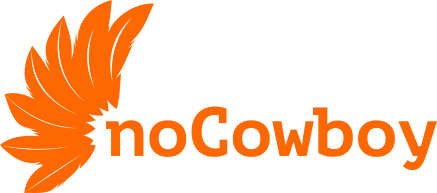

# NoCowboy



**AI-агент для российских разработчиков.** Форк [Kilo Code](https://github.com/Kilo-Org/kilocode). Ни одной зависимости от западных сервисов.

---

## Зачем

1.7 миллиона разработчиков в России. Все западные AI-инструменты — Claude Code, Cursor, Copilot, Codex, Aider — сделаны для англоязычного рынка. Они привязаны к OpenAI и Anthropic, требуют западные карты, не говорят по-русски и могут отключиться в любой момент.

Никто не делает инструмент для нас. Мы сделали.

## Почему не западные инструменты

### Их нельзя оплатить
Visa и Mastercard ушли из РФ. SWIFT-переводы заблокированы. Российские карты не принимает ни один западный AI-сервис. Оплата через посредников — +20-40% комиссии и риск бана без возврата.

### Их могут отключить
Аккаунт Claude, ChatGPT или Copilot может быть заблокирован при обнаружении российского IP или платёжного следа. Ты платишь $20-500 в месяц — а завтра остаёшься без доступа и без денег.

### Они говорят на английском
Все промпты, документация, интерфейс — на английском. Российский контекст (152-ФЗ, требования РКН, локальные стандарты) для них не существует.

### Они дорогие
Claude Sonnet 5: $2 вход + $10 выход за миллион токенов. Месяц разработки — $200-500. DeepSeek V4 Flash: $0.14 + $0.28 — **в 7-18 раз дешевле.** Но западные инструменты заточены под дорогие западные API.

## Что переделано

### Агенты
Шесть агентов с чёткими ролями: **auto** (диспетчер по умолчанию), **architect** (проектирование, ADR), **planner** (спецификации, acceptance criteria), **worker** (реализация, тесты, отладка), **reviewer** (проверка качества, другая модель), **nocowboy** (собеседник). Переключение — Tab / Shift+Tab.

### TUI — интерфейс
Kilo Code вышел с базовым TUI. Мы переделали практически всё:

- **Переключение агентов по Tab** — мгновенная смена агента без меню
- **Кнопки мыши в промпте** — `[Attach]` (файл: картинка/PDF/текст), `[Paste]` (буфер обмена), `[YOLO]` (разрешить всё)
- **YOLO-режим** — глобальное разрешение хранится в конфиге, действует во всех инстансах и переживает перезапуск; явные запреты и защита конфигов всё равно выигрывают
- **Сайдбар с живым статусом** — MCP-серверы, задачи (todo), бейджи вендоров (nc/com), цветовая индикация (зелёный/жёлтый/красный)
- **Вкладки Info → History → Settings** — структурированная навигация вместо плоского списка
- **Управление MCP на лету** — добавить/удалить/включить/выключить сервер без перезапуска
- **Локализация** — словарь ru/en и переключатель языка в настройках
- **35+ тем** — переключение по Ctrl+X T, включая собственную тему nocowboy
- **Фоновые процессы** — dev-серверы, вотчеры запускаются и управляются из TUI
- **Веб-хуки (Channels)** — CI, алерты, уведомления приходят прямо в сессию

### Под капотом
- **Русские промпты и инструкции** — 14 файлов правил на русском
- **Работает с доступными из РФ моделями** — DeepSeek, Kimi, Mistral, GLM, Qwen; локально — Ollama, GigaChat, YandexGPT. Баланс DeepSeek/Kimi/OpenRouter — в сайдбаре
- **Скомпилирован в бинарник** — один файл. Node.js не нужен
- **Память между сессиями — NUTAUSIK (MCP)** — задачи, память, решения, ADR и handoff в общем хранилище; один сервер на все инстансы, проект передаётся с каждым вызовом
- **Бюджет сессии** — лимиты по стоимости и токенам с предупреждением, переходом на дешёвую модель или остановкой (`budget` в конфиге)
- **Кросс-модельное ревью** — reviewer выбирается по семейству модели-автора, вторая фаза ревью (настройка `review.cascade`, по умолчанию выключено)
- **Собственные MCP-серверы** — Constitution (AST-проверка кода), Puppeteer (браузер), Git, SQLite, context7 — стартуют автоматически
- **Self-hosting** — NoCowboy разрабатывает сам себя. Код в этом репозитории написан через NoCowboy

### Что нового в 1.0.3-alpha
Появился **автопилот** — прогон целого roadmap без человека. Команда `/autopilot [scope]` (в TUI) или `nocowboy run --autopilot "<scope>" --max-turns N` (headless/CI) ставит цель и ведёт этапы сама: worker реализует, reviewer-гейт проверяет и фичу с тестами, и **актуальность roadmap**, и только после подтверждения начинается следующий этап. Harness сам продолжает сессию, пока цель не достигнута или не исчерпан бюджет `--max-turns`; зависшие этапы отсекает stall-guard, а `run --continue` возобновляет прерванный прогон. Подробности — в [docs/releases/1.0.3-alpha.md](docs/releases/1.0.3-alpha.md).

## Что дальше

Одна рабочая среда вместо десятка инструментов. Всё в одном TUI:

- **API-клиент** — отправка запросов, просмотр ответов, коллекции, переменные окружения. Не нужен Postman
- **Git-клиент** — просмотр диффов, коммитов, веток. Визуальный merge. Не нужен lazygit
- **База данных** — SQL-запросы, просмотр таблиц, редактирование строк. Не нужен DBeaver
- **Файловый менеджер** — навигация по проекту, просмотр, редактирование. Не нужен ranger/mc
- **Текстовый редактор** — редактирование с AI-помощью: «добавь поле в интерфейс», «поправь типы»

Не надо переключаться между терминалом, IDE, Postman, DBeaver, lazygit, файловым менеджером. Одна среда. Один бинарник.

См. [ROADMAP.md](docs/ROADMAP.md) — раздел P3.

---

## Быстрый старт

```bash
bun install
bun run release        # typecheck + build; обновляет ~/.nocowboy/bin/nocowboy

nocowboy --version     # 1.0.3-alpha
nocowboy init          # мастер настройки
nocowboy mcp start     # MCP-серверы
nocowboy               # старт TUI
```

Конфиг: `~/.config/nocowboy/nocowboy.jsonc`

Проверки перед коммитом: `bun turbo typecheck`, `bun scripts/verify-roadmap.ts` (147/147 фич).

---

## Стек

TypeScript + SolidJS + OpenTUI + Bun. Скомпилирован в один бинарник.

---

## Статус

**v0.7.3 🐕** — 2026-07-02 (первый dogfooding-релиз)
**v0.7.4** — 2026-07-03 (текущая)

[CHANGELOG](docs/CHANGELOG.md) · [ROADMAP](docs/ROADMAP.md)

---

## Лицензия

Проприетарная. Право РФ. Текст разрабатывается — см. P3-L1 в ROADMAP.
